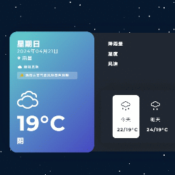

# 极简天气 QWeather (simple-weather-app-design)

一个基于 **Vue 3** 的极简天气应用，同时可作为 **Steam 壁纸引擎（Wallpaper Engine）** 的网页动态壁纸使用。界面灵感来自 CodePen，天气数据由 [和风天气 QWeather](https://www.qweather.com/) 提供。

> 该项目已发布至 Steam 创意工坊：《QWeather🌦️和风天气[测试]》
>
> 🚧 本壁纸目前仍处于 **测试阶段（Beta）**：功能与界面可能继续调整，也可能存在尚未发现的 Bug，欢迎反馈问题与建议。
> Workshop ID：`3149014795`



---

## 功能特性

- **玻璃拟态 UI**：暗色磨砂玻璃卡片，左右分区信息更均衡、更易读，适配深色动态背景
- **实时天气**：当前温度、天气状况与天气图标（QWeather 图标字体）+ 体感温度、今日最高/最低温
- **近 4 天预报**：取和风 7 日预报接口前 4 天数据，支持点击切换查看每天的降雨量、湿度、风向风力、紫外线、平均温度、云量、日出日落
- **生活指数**：当天 7 项指数（运动 / 洗车 / 穿衣 / 紫外线 / 旅游 / 舒适度 / 感冒，QWeather indices 接口）用「4 列选择器 + 说明文字」呈现——说明区每 12 秒自动轮播一条，选中条目的名称与分类显示在「生活指数」标题行右侧，下方用语气色竖线标出该条指数的完整说明；换条动效是「旧的一条向下渐出 → 新的一条再从上方渐入」（`mode="out-in"`，0.3s + 0.35s ≈ 0.65s 一出一进，方向与预警 chip 刻意相反）；点图标可立刻切过去并重新计时。选择器按「出行 / 健康」分组排成两行（运动·洗车·旅游·舒适度 / 穿衣·紫外线·感冒），末行 3 个拉伸填满整行、右下角不留缺口（末尾只剩 1~2 个时自动改为居中）；首次渲染会自动选中「较不宜」这类需要注意的一条
- **分钟级降水**：预警胶囊上方常驻一颗降水胶囊，**直接说整句**（和弹层标题同一句，详情里多一个转折词「不过」）：「未来两小时无降雨 / 15 分钟后下中雨 / 正在下中雨，30 分钟后停，隔 15 分钟又有小雨 / 正在下小雨，即将雨停，隔 20 分钟又有小雨 / 雨刚停，15 分钟后又有小雨 / 正在下中雨，10 分钟后转大雨 / 正在下中雨，未来两小时持续降雨」，文案里的分钟数会随时间自己走；雨停了还会再下时，后半场以**停雨那一刻**为起点说「隔 15 分钟又有小雨」，不用读者自己拿两个绝对时间相减，也不会被误读成「45 分钟后（雨还没停就）转小雨」；停雨只剩一格（≤5 分钟）时说「即将雨停」而不是「5 分钟后雨停」；15 分钟内雨势会跨档时再补一句趋势——「10 分钟后转大雨 / 即将转大雨 / 15 分钟后转中雨」，只说档位不写「雨会变大」（「转多大」才是要传达的信息，还省 50px 宽度），判定要**连续两个点**都落在新档位上（单点抖动会让文案在「转大雨」和「中雨」之间来回闪）且必须比停雨早至少一格（否则会出现「10 分钟后转大雨，10 分钟后停」）；**一句只放两段**——有趋势时就到此为止，不再跟「30 分钟后停」「持续两小时」，三段话信息太密、读的人反而抓不住重点（两段句实测 162px、三段 225px，可用只有 243px），停雨时间交给弹层的柱状图；反过来，同时存在「停一会儿又下」时让位的是趋势，那一支要说「几点停、隔多久又有」，比「差一级」更值得占位置；还没下时说「15 分钟后下中雨」而不是「15 分钟后开始下雨」——带不带伞取决于多大，档位在标题里就交代掉；接口窗口的起点本来就比「现在」早 5~10 分钟（服务端网格延迟），所以雨刚停的那几分钟里胶囊接着说「雨刚停，15 分钟后又有小雨」（再久一点改说「刚才在下小雨…」），不会在雨停那一刻突然跳成「15 分钟后下中雨」、像刚才那场雨没发生过；点开是「未来两小时逐 5 分钟」的柱状图弹层——柱子从**现在这一格**画起（已经过去的那几格不画，「现在」才真的指向现在，上面的累计雨量也和柱子对得上），柱子按小时雨强分级上色（小雨 / 中雨 / 大雨 / 暴雨），图里按真实阈值画了分级虚线，右侧竖排标出「小雨 / 中雨 / 大雨 / 暴雨」这几档（纵轴上限会随雨量自适应，放不下的档自动省略）；鼠标悬停任意一根柱子会高亮该时段、把其余柱子压暗，并在上方浮层里显示「这段是哪 5 分钟 + 这段时间的降水量 + 小时雨强 + 雨量等级」，下方给出累计降水量、最大雨强与预计降水时长，并区分「没有数据（境外不支持 / 临时缺测）/ 请求失败 / 加载中」三种状态。数据来自 `/v7/minutely/5m`（仅覆盖中国、1 km、每 5 分钟更新一次，境外坐标会稳定返回 400），因此它**独立于主流程加载**，失败不会把整张天气卡判成加载失败
- **天气预警**：蓝/黄/橙/红四级配色；主卡片预警自动轮播 + 数量角标；详情采用手风琴展开，溢出内容用 BetterScroll 鼠标拖拽滚动（适配 Wallpaper Engine 无法触发滚轮的场景）
- **一言**：卡片右侧每日一句，点击即可换一句（手动限 5 秒一次；文案缓存 2 小时，过期后自动刷新，请求失败会保留上一条并自动重试）
- **新用户引导（必做）**：引导用户到「壁纸属性」面板填写自己的和风天气 API 域名/密钥，自动检测可用性；只有检测通过并选好位置后才显示天气面板——不再消耗作者的内置公共额度
- **设置 / 状态页**：天气卡右上角齿轮打开，查看当前连接状态、逐组凭据（域名 + 打码密钥 + 失败原因）、一键重新检测、修改指引，以及面板缩放 / 动态背景的只读值；「重新查看新手引导」进入回顾态（不自动前进）。密钥的写入口只在壁纸属性面板，所以这一页不设输入框与「保存」
- **地址选择页**：与天气面板同尺寸、同层级的省市县三级点选页（无搜索框：壁纸引擎收不到页面内的键盘输入），支持热门城市与最近选择；列表用 BetterScroll 拖拽滚动，并自绘可见滚动条（壁纸引擎不转发滚轮事件）
- **城市定位**：选择城市后用 adcode 查询并拉取天气（台湾省按和风 LocationID，见「注意事项」），选择结果与最近记录写入 localStorage
- **超长地名自适应**：对新疆等超长省市区名自动省略号截断，悬浮显示完整地名
- **动态背景系统**（3 种模式，可通过壁纸属性或 localStorage 切换，默认 `4`）：
  - `0` 无背景
  - `4` 实时渲染雨滴（WebGL，可选隐藏天气面板全屏沉浸）
  - `5` 整页雨珠叠加（WebGL 透明雨珠层盖在真实 DOM 之上，天气面板照样被雨珠折射、照样可点）
  - 原 `1` 3D 小鸟 / `2` 星空 / `3` 动态粒子已移除；序号仍保留 `4`、`5`，老配置无需迁移
- **智能雨滴**：`4` / `5` 两种雨滴背景都支持「自动」模式——按分钟级降水里「现在」这一格（与胶囊、弹层共用同一个时钟和同一套解析）换算小时雨强，自动匹配暴雨/大雨/中雨/小雨/无雨；分钟级不可用（境外 / 失败 / 未加载 / 数据过期）时回退实时天气图标与文本
- **数据缓存与自动刷新**：按数据类型独立缓存（实时 10 分钟 / 预报 2 小时 / 预警 10 分钟 / 生活指数 6 小时 / 分钟级降水 5 分钟，均取自和风天气官方推荐区间，统一在 `src/config/weatherCache.js` 管理），逐天预报与生活指数跨本地零点自动失效，页面每分钟自动轮询，过期数据自动重新拉取；生活指数与分钟级降水都不进主周期，分别错峰 / 独立加载
- **断网/失败恢复**：离线时显示离线状态，网络恢复自动重连；请求失败每 5 秒重试，连续失败超过 5 次降频为 30 秒重试
- **多域名负载均衡**：用户可在属性面板里填多组「域名 + 密钥」（英文逗号分隔、按顺序配对），请求按域名轮询切换；轮询下标持久化到 localStorage，首次运行随机取起点，避免第一个域名被过度请求

## 技术栈

| 分类 | 技术 |
| --- | --- |
| 框架 | Vue 3（`<script setup>` 组合式 API）、Vue CLI 5 |
| 状态管理 | Pinia + pinia-plugin-persistedstate（状态持久化到 localStorage） |
| 请求 | Axios（拦截器注入密钥、统一错误码处理） |
| UI | Arco Design Vue（Cascader 级联选择、Button、Icon） |
| 动效 | raindrop-fx（雨滴 WebGL）、@better-scroll/core、@formkit/auto-animate |
| 工具 | @vueuse/core（useStorage）、mitt（事件总线）、qweather-icons |
| 样式 | Sass/SCSS、本地化 Montserrat 字体、iconfont 图标 |

## 快速开始

环境要求：Node.js 14+，推荐使用 Yarn（项目同时提供 `package-lock.json`，npm 亦可）。

```bash
# 安装依赖
yarn install

# 启动开发服务器（热更新）
yarn serve

# 生产构建：输出到 dist/，并同步到 Wallpaper Engine 工程目录
yarn build

# 只构建到 dist/，不同步壁纸工程
yarn build:dist

# 代码检查与修复
yarn lint
```

也可以直接双击根目录下的 `start.bat`（等价于执行 `yarn serve`）。

由于 `vue.config.js` 中配置了 `publicPath: './'`，打包后的文件可以直接在本地以相对路径打开运行，方便作为壁纸引擎的本地网页源使用。

### 同步到 Wallpaper Engine 工程

`yarn build` 会先把构建产物输出到 `dist/`，随后由 `scripts/deploy-wallpaper-engine.js` 同步到壁纸工程目录，省去手动复制：

```bash
# 只同步现有的 dist/（不重新构建）
yarn deploy:we

# 工程目录不在默认位置时，用环境变量指定
WE_PROJECT_DIR="D:/path/to/we/project" yarn deploy:we
```

默认工程目录为 `D:/Steam/steamapps/common/wallpaper_engine/projects/myprojects/qweater`，脚本用它作为 `dist` 的镜像输出目录，行为如下：

- 先删除工程目录里的上一轮构建产物（`index.html`、`js/`、`css/`、`img/`、`fonts/`、`favicon.ico` 等），避免旧 hash 文件堆积；
- 再把 `dist/` 里的内容写入工程目录；
- **保留** `preview.jpg` 等由 Wallpaper Engine 自己维护的文件，不会被 `public/` 里的旧版本覆盖；
- `project.json` 只合并其中的**壁纸属性定义**（`general.properties`，以 `public/project.json` 为准，写回前会按 `order` 重新编号 `index`），
  `workshopid`、`version`、`preview`、`description`、`tags` 等由壁纸引擎维护的字段原样保留；
  不想合并时加 `WE_SYNC_PROPERTIES=0`；
- 如果目标目录不存在或缺少 `project.json`，脚本会直接报错退出，不会误删其他目录。

> 为什么必须合并属性定义：壁纸引擎读的是**工程目录里**的 `project.json`，而不是 `public/project.json`。
> 只改 `public/project.json` 而不合并的话，属性面板里看不到新加的选项（例如 `backgroundindex` 的「整页雨珠叠加」），
> 于是「明明代码支持，却没法在壁纸属性里打开」。

## 环境变量配置

`.env` 只用于覆盖**缓存时效**等非敏感配置，已被 `.gitignore` 忽略（模板见 `.env.example`）。

> ⚠️ **不要把任何密钥写进 `.env` / `.env.local`**：`vue-cli` 会把所有 `VUE_APP_*` 内联进 `dist/js/*.js`（明文），
> 等于随安装包公开分发。和风天气的域名 / 密钥、高德 Web服务 key 都只在应用里填写：
> Wallpaper Engine 用「壁纸属性」面板（`qweatherhost` / `qweatherkey` / `amapkey`），
> 浏览器开发用右上角调试面板（存 localStorage）。读写逻辑见 `src/api/credentials.js`。

```ini
# 缓存时效（可选覆盖；默认值统一在 src/config/weatherCache.js，取自和风官方推荐）
# 需要覆盖时取消对应注释，单位毫秒
# VUE_APP_WEATHER_UPDATE_REALTIME=600000    # 实时天气：10 分钟（官方 10-30 分钟）
# VUE_APP_WEATHER_UPDATE_FOURDAYS=7200000   # 逐天预报：2 小时（官方 1-6 小时）
# VUE_APP_WEATHER_UPDATE_WARNING=600000     # 天气预警：10 分钟（官方 5-20 分钟）
# VUE_APP_WEATHER_UPDATE_INDICES=21600000   # 生活指数：6 小时（官方 6-12 小时）
# VUE_APP_WEATHER_UPDATE_MINUTELY=300000    # 分钟级降水：5 分钟（官方 5-10 分钟）
```

> 说明：高德 Web服务 key 没有域名白名单，所以只作为属性 `amapkey` 由用户自填；不填时地图选点的地址
> 退回和风 GeoAPI 的区县反查（`市 区县附近`，例如「台州市 黄岩附近」），见下文「地图选点的地址文案」。

> 说明：天气请求一律使用用户在壁纸属性面板里填写的域名与密钥（见下文「用户自带 API 域名/密钥与新用户引导」），
> 源码和构建产物都不再读取、也不再包含任何密钥。

## 项目结构

```text
simple-weather-app-design
├── public/                        # 静态资源（壁纸引擎入口）
│   ├── index.html                 # 入口 HTML（Vue CLI 模板）
│   ├── project.json               # Steam 创意工坊壁纸属性配置（含说明/更新日志）
│   ├── preview.gif                # 创意工坊预览图
│   └── fonts/                     # QWeather 图标字体
├── src/
│   ├── main.js                    # 应用入口（注册 Pinia、auto-animate）
│   ├── App.vue                    # 根组件：背景 + 天气面板 + 预警/分钟级降水弹窗
│   ├── api/
│   │   ├── weather.js             # 和风天气接口封装（定位/7日/实时/预警/生活指数/分钟级降水）
│   │   ├── httpClient.js          # Axios 实例（密钥注入/错误码/离线状态）
│   │   ├── credentials.js         # 用户自带的域名/密钥：解析、校验、指纹、失败域名剔除
│   │   ├── hostPool.js            # 多域名/多 Key 轮询池（数据源=用户填写）
│   │   └── errors.js              # 统一错误封装
│   ├── config/
│   │   └── weatherCache.js        # 各接口缓存时效（和风官方推荐值 + 跨天/时区规则 + .env 覆盖）
│   ├── data/
│   │   └── CityList.js            # 全国省市区划数据（内地为 adcode，台湾为和风 LocationID）
│   ├── features/
│   │   ├── weather/
│   │   │   ├── WeatherMain.vue        # 天气主面板（玻璃卡片：当前/预报/指数/一言）
│   │   │   ├── LocationPicker.vue     # 地址选择页（省/市/区三级 + 热门 + 最近，含地图全屏）
│   │   │   ├── RegionCascade.vue      # 省/市/区三列（三列页与全屏「重选地区」卡片共用）
│   │   │   ├── RegionPickerDialog.vue # 全屏地图上的「重选地区」悬浮卡片（不改全屏、不丢视野）
│   │   │   ├── regionTree.js          # 地区树读取规则（findNode / 叶子 / 需先选城市…）
│   │   │   ├── MapPointPicker.vue     # 地图选点（高德瓦片：拖动平移/滚轮·双击缩放/落点，选点后显示路名或「市 区县附近」）
│   │   │   ├── mapTiles.js            # 瓦片投影与坐标换算（WGS-84 ↔ GCJ-02）
│   │   │   ├── reverseGeocode.js      # 高德逆地理编码：坐标 → 最近道路名（带缓存/取消/超时，可选）
│   │   │   ├── placeLookup.js         # 和风 GeoAPI 坐标反查：坐标 → 区县（无高德 key 时的地址兜底）
│   │   │   ├── pointAddress.js        # 坐标 → 地址的两级兜底（高德路名 → 和风区县，密钥变更后重查用）
│   │   │   ├── PickerColumn.vue       # 地址页单列（BetterScroll 拖拽 + 自绘滚动条）
│   │   │   ├── useLocationHistory.js  # 最近选择记录（支持按新密钥重查坐标级地名）
│   │   │   ├── useAddressRefresh.js   # 高德密钥变化 → 卡片地址与「最近」记录自动重查
│   │   │   ├── betterScroll.js        # BetterScroll 统一入口（只注册一次滚轮插件）
│   │   │   ├── SelectLocationDialog.vue # 旧版城市选择弹窗（已停用，保留文件）
│   │   │   ├── WelcomeModal.vue       # 旧版首次使用欢迎弹窗（已停用，保留文件）
│   │   │   ├── EarlyWarningDetails.vue# 天气预警详情（手风琴 + BetterScroll）
│   │   │   ├── MinutelyRainChip.vue   # 分钟级降水胶囊（常驻在预警胶囊前面）
│   │   │   ├── MinutelyRainDialog.vue # 分钟级降水弹层（未来两小时柱状图，悬停看单柱明细）
│   │   │   ├── minutelyRain.js        # 分钟级降水的解读：雨强分级、几分钟后停/下
│   │   │   ├── WeatherStateIndicator.vue# 加载/更新状态提示
│   │   │   ├── useWeatherRefresh.js   # 定时刷新 + 失败重试
│   │   │   └── useWeatherStore.js     # 天气状态：数据、缓存、加载状态
│   │   ├── onboarding/
│   │   │   ├── OnboardingPanel.vue    # 新用户引导面板（说明 + 状态 + 检测结果）
│   │   │   ├── SettingsPanel.vue      # 设置/状态页（连接状态、凭据、修改指引、外观只读）
│   │   │   ├── CredentialStatusCard.vue# 检测结果卡（引导页与设置页共用）
│   │   │   ├── ApiHelpPanel.vue       # 帮助页：怎么申请 API、免费额度与计费表
│   │   │   └── onboardingState.js     # 引导/设置状态机：检测、指纹缓存、面板开关
│   │   └── wallpaper/
│   │       ├── WallpaperDebugPanel.vue# 开发环境壁纸属性调试面板
│   │       ├── properties.js          # 壁纸属性状态/监听（WE/调试共用）
│   │       ├── constants.js           # 壁纸属性 Key、Bus 事件、存储 Key
│   │       ├── backgroundConfig.js    # 各背景专属配置
│   │       └── backgrounds/
│   │           ├── BackgroundMain.vue # 背景切换 + 壁纸属性监听
│   │           ├── rain/
│   │           │   ├── RainEffect.vue # WebGL 实时雨滴（自带背景图）
│   │           │   ├── RainEffectCore.js # raindrop-fx v1.0.8 bundle
│   │           │   └── RainConfig.js  # 大/中/小/无雨预设
│   │           └── rain-overlay/      # 整页雨珠叠加（盖在真实 DOM 上）
│   │               ├── RainOverlayEffect.vue # 底图 + 全屏雨珠叠加层
│   │               ├── RainOverlayAdapter.js # 透明叠加补丁 + DOM 快照折射源
│   │               ├── RainOverlayConfig.js  # 叠加背景专属的雨量预设（与 rain/ 分开维护）
│   │               └── lib/
│   │                   ├── raindrop-fx.js    # raindrop-fx v1.0.8 bundle
│   │                   └── html2canvas.min.js# 1.4.1，把 DOM 光栅化成折射纹理
│   ├── shared/
│   │   ├── Bus.js                 # mitt 事件总线
│   │   ├── clipboard.js           # 复制到剪贴板（execCommand 兜底）+ 控制台网址
│   │   └── env.js                 # 运行环境判定（壁纸引擎 / 普通浏览器）
│   ├── store/
│   │   ├── index.js                # Pinia 实例（含持久化插件）
│   │   └── modules/
│   │       └── useWallpaperOptionsStore.js # 壁纸选项 store
│   ├── style/                      # 全局样式、设计令牌、字体、图标
│   │   ├── weather-panel.scss      # 天气卡/引导页/设置页/地址页共用的层级与尺寸外壳
│   │   └── transitions.scss        # 全站切换动效（进场/离场/轮播）的唯一定义处
│   ├── assets/
│   │   ├── dock-1365387_1920.jpg       # 雨滴背景底图（清晰，供 `4` 用）
│   │   └── dock-1365387_1920-blur.jpg  # 同一张图的预模糊版（供 `5` 的底图用）
│   └── fonts/                      # Montserrat 本地字体
├── .env                            # 本地环境变量（仅缓存时效，已被 .gitignore 忽略）
├── vue.config.js                   # CLI 配置（相对路径、关闭 sourcemap 等）
├── jsconfig.json                   # 路径别名 @ -> src
├── scripts/
│   ├── deploy-wallpaper-engine.js  # 把 dist/ 同步到壁纸工程目录（合并属性面板定义）
│   └── sync-taiwan-city-list.js    # 用和风官方城市列表刷新 CityList.js 里的台湾省数据
└── start.bat                       # 一键启动脚本
```

## 核心实现说明

### 数据流

`WeatherMain.vue` 挂载后调用 `updateWeather()`，每 60 秒轮询一次：

1. 先检查 `navigator.onLine`，离线则进入「已离线」状态，监听 `online` 事件自动恢复；
2. 并行请求「4 日预报 / 实时天气 / 天气预警」三个接口；生活指数独立、尽力而为地请求，失败不影响整体状态；
3. 每次请求前先校验数据缓存时效（见 `src/config/weatherCache.js`，`.env` 可覆盖），未过期直接使用本地数据；同一接口 + 同一城市的在途请求会复用同一个 Promise，避免手动定位与定时轮询撞车时重复请求；
4. 生活指数不在主周期内发送，而是错峰 30 秒、按独立节拍刷新，使每个定时周期的请求数（3 个）与多域名池大小一致；
5. 分钟级降水同样**不进主流程**：它在主周期里 fire-and-forget（`getLocationInformation` 不 await 它），另有 5 分钟缓存门槛，
   所以大多数轮询周期不会多发请求；境外坐标得到的 400 `data-not-available` 只把胶囊切成「分钟级降水暂不可用」，
   既不进 `Promise.allSettled`（否则海外用户整张卡都会被判成部分失败），也不会触发重新认证；
6. 成功后写入 Pinia store（持久化到 localStorage），失败按 5 秒 / 30 秒退避重试；
   分钟级降水则不持久化（重载页面宁可重拉一次，也不想把两小时前的雨画在今天的卡片上）。

> 持久化密钥带有版本号：天气数据为 `WeatherApp-2026-9-1`，壁纸选项为 `WallpaperOptions-2026-9.1`。
> 每次数据源/结构变化时更新版本号即可让用户端强制重新拉取，避免读到旧结构的缓存。
>
> 请求量估算（用于帮助页的额度说明）：轮询周期 60 秒，但请求由缓存时效决定——
> 实时天气 10 分钟（48 次/天）、预警 10 分钟（48 次/天）、预报 2 小时（4 次/天）、
> 生活指数 6 小时（2 次/天）、分钟级降水 5 分钟（96 次/天），
> 按每天运行 8 小时、每月 31 天算，合计约 198 次/天 ≈ 6100 次/月，约占和风天气免费额度（50000 次/月）的 12%。
> 分钟级降水是其中最大的一项；如果只想省额度，把 `.env` 里的
> `VUE_APP_WEATHER_UPDATE_MINUTELY` 调到 600000（10 分钟，官方区间上限）即可减半，代价是雨的起止时间会旧最多 10 分钟。

### 缓存时效（和风天气官方推荐）

所有时长集中在一个文件：`src/config/weatherCache.js`，依据官方[《缓存你的数据》](https://dev.qweather.com/docs/best-practices/cache/)：

| 数据 | 本项目 | 官方推荐区间 | 官方更新频率 |
| --- | --- | --- | --- |
| 实时天气 | 10 分钟 | 10-30 分钟 | 5-10 分钟 |
| 逐天预报 | 2 小时 | 1-6 小时 | 60 分钟 |
| 天气预警 | 10 分钟 | 5-20 分钟 | 3 分钟 |
| 生活指数 | 6 小时 | 6-12 小时 | 60 分钟 |
| 分钟级降水 | 5 分钟 | 5-10 分钟 | 5 分钟 |

- **合理性**：实时天气取官方区间下限 10 分钟 —— 官方提示「缓存与原数据最多相差 2 倍」，
  5-10 分钟更新一次的数据配 10 分钟缓存，最坏间隔 15-20 分钟，正好卡在这条线内。
- **弹性**：逐天预报 / 生活指数 / 实时天气除了 TTL，还会在**查询地点的本地零点**强制失效
  （`crossLocalDay`）。官方举的例子是 23:59 拉到的 7 天预报，00:00 之后第一天变成「昨天」，
  只靠 TTL 兜不住。本地日期用 `Intl.DateTimeFormat` 按 IANA 时区计算，夏令时切换当天也算得对，
  所以看境外天气时按的是当地零点，不是用户机器的零点。
- **覆盖**：`.env` 里的 `VUE_APP_WEATHER_UPDATE_*`（毫秒）仍然生效；超出官方区间只打控制台警告、
  不拦截，方便本地调试；空值 / 0 / 负数回退默认值。
- **清除**：官方要求缓存能立即清除。本项目的开关是 `useWeatherStore.js` 的 `CACHE_VERSION` +1
  （见下文「改版后让老缓存立刻失效」），不需要发新版本。
- **GeoAPI 不缓存**：官方明确禁止缓存、提取或批量存储城市搜索数据。`lookupCity` 只在选地址时
  实时查一次，结果不落盘，`weatherCache.js` 里也没有 geo 项。

### 加载状态码

store 中的 `TheWeatherDataIsLoaded` 用于驱动天气面板的状态提示：

| 状态码 | 含义 |
| --- | --- |
| `100` | 加载中 |
| `200` | 加载成功（显示“刚刚更新 / X 分钟前更新”） |
| `300` | 请求失败，正在重试 |
| `400` | 无网络（离线） |
| `0` | 未知错误（建议重新应用壁纸） |

### 壁纸引擎（Wallpaper Engine）集成

壁纸属性定义在 `public/project.json`（`yarn build` / `yarn deploy:we` 会把其中的属性定义合并进壁纸工程目录的 `project.json`），用户可在壁纸设置面板实时调整：

| 属性 | 类型 | 说明 |
| --- | --- | --- |
| `backgroundindex` | 下拉框 | 切换背景：0 无 / 4 雨滴（默认） / 5 整页雨珠叠加 |
| `showweathermain` | 开关 | 雨滴模式下隐藏/显示天气面板 |
| `rainconfig` | 下拉框 | 雨滴强度：自动 / 暴雨 / 大雨 / 中雨 / 小雨 / 雨停 |
| `panelscale` | 滑块 | 天气面板整体缩放（0.5 ~ 1.5，默认 0.75） |
| `qweatherhost` | 文本框 | 用户自己的和风天气 API 域名；多个用英文逗号分隔 |
| `qweatherkey` | 文本框 | 用户自己的和风天气 API 密钥；与域名按顺序一一配对 |
| `amapkey` | 文本框 | **选填**。用户自己的高德「Web服务」key：填了地图选点显示最近道路名；留空时改用和风区县反查显示「市 区县附近」 |

切换背景时会通过 mitt 事件总线（`Bus.js`）通知 `WeatherMain` 隐藏天气面板。

#### 地图选点的地址文案（高德路名 / 和风「区县附近」）

天气始终按经纬度查询，但卡片上要给人看一个地名。地图选点的地址分两档：

1. **填了高德 key**：`reverseGeocode.js` 调高德逆地理编码，得到
   「浙江省-台州市-黄岩区-新前街道-中学路」，卡片显示「黄岩区 中学路」；
2. **没填高德 key**：`placeLookup.js` 用和风自带的 `/geo/v2/city/lookup` 按坐标反查最近的区县
   （返回 `adm1` 省 / `adm2` 市 / `name` 区县）。和风只覆盖三级行政区，没有街道和道路，
   所以卡片显示「台州市 黄岩附近」——只写一个区名太单薄，也难分辨同名区县，因此把市名一起带上；
   地图页标题是「浙江省-台州市-黄岩附近」。

关键原则：**只要 pin 是地图上点出来的，地址就只认坐标级地名，绝不拿三级下拉框的路径顶替**。
用户完全可能在下拉框里选北京、再把 pin 拖到天津；天气按坐标查天津，地址也必须跟着变成天津的区县。
`point.district` / `point.city` / `point.road` 一起落库，`point.districtSource` 记录地名来源
（`amap` / `qweather`）；老记录没有 source 时，用同一次坐标查询得到的 `CityDetail.name` 核对，对不上就以坐标为准。

运行中在壁纸属性面板补填 / 清空高德 key 时，`useAddressRefresh.js` 会按新精度重查
「当前点位 + 最近记录」的坐标级地名（只改地址、不重发天气请求），卡片和「最近」列表立刻同步：
补上 key 会从「台州市 黄岩附近」升级成「黄岩区 中学路」，清空 key 则退回「附近」写法。
重查按高德个人版 QPS 3 排队（每条间隔 360ms），并用请求序号丢弃过期结果；
旧版本写下的历史文案没有市名时，重新选一次同一个点、或改变一次 key 也会补上。

几个实现要点：

1. 和风反查和天气共用同一套域名轮询池、凭据与错误表，不额外引入请求通道；
2. 和风坐标只接受两位小数（约 1.1 km），结果按两位小数缓存 + 150ms 去抖 + 请求序号丢弃过期响应；
3. 和风返回的是「离坐标最近的城市」，不是「包含坐标的行政区」。邻区中心更近时可能返回邻区
   （实测徐闻附近会返回海口美兰、青海湖附近会返回兴海）。所以文案一律带「附近」，
   悬停还能看到「距该区县中心约 N 公里」；天气本身不受这条影响；
4. 如果是「没点地图、只用区县中心」确认，仍然按 adcode 查天气，地址用完整的三级路径；
5. 高德 key 仍然完全可选：没填 / 填错 / 额度用尽 / 郊区无命名道路时静默退回和风，
   选点与天气都不受影响；
6. 坐标系按和风的规范：**中国大陆用 GCJ-02，其他地区用 WGS-84**
   （[官方词汇表](https://dev.qweather.com/docs/resource/glossary/#coordinate)）。
   高德瓦片正好是 GCJ-02，所以地图点选的坐标**不做转换**，直接落库、直接查天气；
   `reverseGeocode(lng, lat)` 默认就按这个坐标系收参，只有手里是 GPS / WGS-84 坐标时
   才传 `{ crs: 'WGS84' }`。换用 WGS-84 底图源（`TILE_SOURCES.osm`）时才需要换算，
   见 `mapTiles.js` 的 `toQueryCoord` / `toMapCoord`。升级前的记录存的是 WGS-84，
   启动时会按 `point.crs` 标记自动迁移一次（`useWeatherStore` / `useLocationHistory`），
   否则老用户的 pin 会整体偏 ~500 m；
7. 高德结果按 1e-5 度取整（约 1 m）缓存，同一个 pin 反复确认不会重复消耗 QPS 3 的额度。
8. 高德 key 走 `src/api/credentials.js`，与和风凭据同一套「引擎下发 + localStorage 兜底 +
   加载阶段空值不覆盖」逻辑；必须用**高德 Web服务**类型的 key（`restapi.amap.com`），不是 Web端（JS API）。

#### 用户自带 API 域名/密钥、新用户引导与设置页

壁纸内置的公共额度不足以支撑所有用户，同时 Wallpaper Engine 的网页壁纸**收不到页面内的键盘输入**，
所以域名和密钥只能在壁纸属性面板里填写，页面负责读取、检测与引导：

1. **引导页**（`src/features/onboarding/OnboardingPanel.vue`）：说明为什么需要用户自己的密钥、去哪里填、
   并实时显示读取到的域名与密钥（密钥打码）与检测结果。地址、大小与天气卡完全一致（见 `src/style/weather-panel.scss`）。
2. **自动检测**（`src/features/onboarding/onboardingState.js`）：属性下发后去抖 700ms，用
   `/geo/v2/city/lookup` 逐组检测（1 组 1 次请求，同时验证域名可达性、密钥有效性与接口权限）。
   `401 / 403 / 429` 等明确错误只给修复提示与重试；超时、断网等临时问题额外给一个「网络异常，仍然继续」。
3. **检测结果按凭据指纹缓存**：只存哈希，凭据没变就不再重复检测（省用户额度）；凭据只来自属性面板 / localStorage，构建产物里不含任何密钥。
4. **地址选择页**（`src/features/weather/LocationPicker.vue`）：检测通过后进入，省 → 市 → 区/县三级点选，
   选到市或区县都会进入地图选点（点热门城市同理，不再点一下就直接拉天气），地图这一步再确认；
   只选到省 / 自治区时按钮是禁用的「请先选择城市」（和风不认省级 adcode，`440000` 会返回 400），
   直辖市（北京/天津/上海/重庆）与港澳本身可查询，仍保留「就用 X」/「下一步」；热门城市与最近 6 条记录；
   每一列都是 BetterScroll 拖拽滚动 + 自绘可见滚动条。
   地图支持滚轮按比例连续缩放（短补间、鼠标一格约 9%）、双击缩放（左键放大 / 右键缩小）与拖动平移，
   缩小时会预加载视口外一圈瓦片，也可以全屏
   （缩放胶囊最右一颗，Esc 退出）：全屏时底部「重选地区」不再退回三列页，
   而是叠一块 `RegionPickerDialog`（省/市/区三列 + 草稿路径）——取消不动地图，确认后按街道级原地飞过去，
   全屏和刚调好的视野都不会丢。卡片形态下点「重选地区」仍回到三列页（那里本来就是一整块选择界面）。
5. **进入天气面板**：选好位置后才会请求天气并显示面板；日常点左上角地址同样打开这个地址页
   （旧的 `SelectLocationDialog.vue` 已不再调用，文件保留）。
   这里有三条不能改坏的约束：① 只有 `WeatherLocationPath` 真的保存过且与当前路径一致时，才把
   `WeatherChosenCity.point` 摆成地图上的 pin（否则「有旧坐标、没旧路径」会让地址页一打开就跳过三列直接进地图，
   按钮直接是「就用这里」）；② `markLocationChosen` 必须在用户点确认时**无条件**调用——它同时负责让引导页让位，
   少了它就会出现「天气请求都发出去了、界面一帧不动、也没有报错」的死局；③ 三列的选中项要在挂载后主动滚到可见位置，
   否则带历史路径打开时列表停在顶部，看起来像历史选择没生效。
6. **设置 / 状态页**（`src/features/onboarding/SettingsPanel.vue`）：天气卡右上角的齿轮打开，和引导页是两个面板——
   引导页回答「第一次怎么配」，设置页回答「现在什么状态、去哪儿改」：检测结果卡（与引导页共用
   `CredentialStatusCard.vue`）、逐组凭据（域名 + 打码密钥 + 可用/失败原因）、重新检测、修改步骤、
   外观与背景的只读值、开源仓库与免责声明。**这一页刻意不放输入框和「保存」**：域名/密钥的写入口只在
   壁纸属性面板（引擎侧）或右上角调试悬浮块（浏览器开发态），页面里能改却不生效比不改更糟。
   最下面的「重新查看新手引导」会让引导页进入**回顾态**
   （`OnboardingReview`）：文案换成回顾语气，且不触发 9 秒自动前进。
   这一页也是「齿轮为什么不该打开引导页」的答案：齿轮只出现在天气卡里，能点到它的人一定已经配置完成，
   再看到「首次使用 / 还差一步，才能显示天气」并等 9 秒自动弹回，语义和体验都是错的。
7. **帮助页**（`src/features/onboarding/ApiHelpPanel.vue`）：引导页与设置页上的教程入口打开——
   控制台网址（点击即可写入剪贴板，`src/shared/clipboard.js` 里带 `execCommand` 兜底，适配壁纸引擎）、
   API Host / KEY 的获取路径（设置 → API Host；项目管理 → 创建项目 → 创建凭据 → 选 API KEY）、
   属性面板的填写位置，以及「每月 50000 次请求免费」的额度说明与计费表；
   引导页底部是开源仓库地址（点击复制）与免责声明（开源无盈利、密钥仅保存在本机、数据仅供参考）；
   控制台网址只在帮助页出现，引导页不再重复。

运行过程中如果和风接口返回 `401 / 402 / 403`，会通过 `Bus`（`BUS_EVENTS.USER_API_INVALID`）通知引导页重新打开并提示原因；
如果当时正停在设置页，设置页会被一起关掉，避免修好凭据后又弹回一个过期的设置页。

**开发环境**：在 Edge 等普通浏览器里打开（`yarn serve`），引导页与设置页都不再提供输入框，
凭据统一在右上角「壁纸属性调试」悬浮块里填写；该悬浮块只在 development 构建里出现，
直接打开打包后的 `dist/index.html` 时没有页面内输入入口，只能在壁纸引擎的属性面板里填。
悬浮块同时提供「打开设置页 / 打开引导页 / 模拟首次使用」按钮。

高德 key 同理：`yarn serve` 时在右上角调试面板的「高德密钥（选填）」里填一次，写入 localStorage
（`WallpaperUserAmapKey`），之后刷新 / 重启都不用再填；发布用的 `dist` 里不含任何高德 key。
不填也完全可用——地图选点的地址会走和风区县反查（显示「市 区县附近」），和天气共用同一套和风凭据，
不需要额外配置。运行中补填 / 清空 key 会立即刷新卡片地址与「最近」记录（见 `useAddressRefresh.js`），
不需要重新选点，也不会重新请求天气。

#### 属性监听器为什么写在 index.html 里

官方文档（Web Wallpaper Reference → User Properties → Reading property values）有两条硬性要求：

1. `window.wallpaperPropertyListener` 必须在**任何事件之外、尽可能早**初始化为全局对象，
   否则壁纸加载时引擎下发的那一次属性更新会丢失（用户选好的背景就“打不开”）；
2. 加载时会**一次性下发全部属性**，之后每次只下发**发生变化**的属性，
   所以每个属性都要单独判空，不能假设一次能拿到所有字段。

因此实现拆成两段：

| 位置 | 职责 |
| --- | --- |
| `public/index.html` 的 `<head>` | 最早把 `window.wallpaperPropertyListener` 挂到全局，并把引擎下发的属性推进队列（`window.__wallpaperPropertyQueue`） |
| `src/features/wallpaper/properties.js` | `setupWallpaperPropertyListener()`：由 `src/main.js` 在 `mount()` 之后调用，先补发队列里的属性（此时组件与 Bus 监听器都已就绪），再把 `applyWallpaperProperties` 挂到消费列表接收后续变更 |

`applyWallpaperProperties` 会校验取值（`backgroundindex` 只认 `0` / `4` / `5`，`rainconfig` 只认六个档位），
非法值打警告并忽略，避免引擎下发的异常值把界面切到空白背景；localStorage 里残留的旧序号 `1`/`2`/`3`
也会在启动时回退到默认背景。

**开发环境调试**：`window.wallpaperPropertyListener` 只在 Wallpaper Engine 中存在，
因此在开发模式下由 `WallpaperDebugPanel.vue`（页面右上角，基于 Arco Design 组件构建）
模拟壁纸属性面板。面板按 `public/project.json` 中 `backgroundindex` 的 condition 划分：
`背景` 是全局切换属性，`隐藏天气面板` 只在“实时雨滴”背景显示，
`雨滴配置` 在“实时雨滴”与“整页雨珠叠加”两个背景下都显示，均出现在对应背景的“专属配置”区块中。
它和壁纸引擎走同一套 `applyWallpaperProperties` 处理逻辑（见 `src/features/wallpaper/properties.js`），
调试结果与生产环境一致；修改会持久化到 localStorage，切换背景刷新页面后自动恢复。

此外每个背景还有**运行时效果参数**（见 `src/features/wallpaper/backgroundConfig.js`），按背景序号分开存储、
互不干扰：实时雨滴与整页雨珠叠加都可调雨滴大小、每秒数量与同时存在上限
（覆盖在雨滴强度预设之上，“雨停”除外），整页雨珠叠加还多出快照分辨率与快照间隔，
它们与 `rainconfig` 同处对应背景的“专属配置”区块。
面板中切换到对应背景即可看到并实时调整这些参数，修改后立即生效并持久化；给其他背景新增
可调参数时，只需在 `backgroundConfigSchema` 中补充字段定义并让对应组件应用即可。

### 整页雨珠叠加（backgroundindex = 5）

`4 实时渲染雨滴` 是「全屏后处理」：raindrop-fx 每帧把传入的背景图铺满 canvas，再合成雨滴折射，
输出永远是一张不透明画面，所以它必须自带背景图，也只能盖在页面之上当背景。

`5 整页雨珠叠加` 把这一步换掉——由 `RainOverlayAdapter.js` 顶替 raindrop-fx 的 `renderer.drawBackground`，
改成把画布清成 `(0,0,0,0)` 全透明，canvas 上就只剩 alpha = 雨滴遮罩 的那一层，
再配上 `position: fixed; pointer-events: none` 盖在整个页面上：底图与天气面板都会被雨珠折射，
面板照常可点（已用命中测试验证 `document.elementFromPoint` 命中的仍是面板里的按钮本身）。

- **折射源**：`RainOverlayEffect.vue` 以 `document.body` 为源，用 html2canvas 把整页光栅化成纹理。
  叠加层自己的 canvas 带 `data-html2canvas-ignore`，不会被拍进自己的快照（否则会形成反馈环）。
  页面里若已有 canvas / video / img，也可以直接把它们当折射源，零成本且可每帧更新。
- **底图是预模糊的**：`dock-1365387_1920-blur.jpg` 是把底图用高斯模糊（sigma ≈ 16）烘焙后的版本。
  之所以不用 CSS `filter: blur()`：html2canvas 不支持 CSS filter，快照里会变回清晰图，
  于是雨珠内部折射出的内容会和可见底图对不上；烘焙进图片则两边天然一致，还顺带省了运行时开销，
  体积也从 620KB 降到 80KB。想换模糊程度用 `temp/_tools/blur-image.py` 重新生成即可：
  `python blur-image.py 原图.jpg 输出.jpg --sigma 16 --quality 85`。
- **性能**：折射不需要高分辨率、也不需要高帧率（雨滴内部本来就是被折射+模糊的小采样），
  默认快照分辨率 `0.25`、间隔 `400ms`，两者都能在调试面板里实时调整。
  帧率吃紧时优先降分辨率、再拉长间隔。
- **雨量预设单独一套**：见 `rain-overlay/RainOverlayConfig.js`，与 `rain/RainConfig.js` 完全独立。
  `4` 的雨滴画在不透明底图上，可以又大又密；`5` 的雨珠盖在真实文字上，同一套参数会糊住内容，
  所以 `5` 的雨滴整体更小更疏、拖尾更克制。四档的差异：

  | 档位 | 生成间隔 | 雨滴尺寸 | 同时上限 | 重力 | 拖尾密度 |
  | --- | --- | --- | --- | --- | --- |
  | 小雨 | 0.42–0.68s（≈1.8 滴/秒） | 26–50px | 60 | 1500 | 0.12 |
  | 中雨（默认） | 0.15–0.24s（≈5 滴/秒） | 40–78px | 150 | 2200 | 0.18 |
  | 大雨 | 0.04–0.07s（≈18 滴/秒） | 62–112px | 320 | 3300 | 0.30 |
  | 暴雨 | 0.018–0.04s（≈34 滴/秒） | 76–138px | 460 | 3700 | 0.38 |
  | 雨停 | — | — | 0 | — | — |

- **自动档怎么同步天气**：见 `src/features/wallpaper/rainIntensity.js`，两个雨滴背景共用同一个映射。
  优先取分钟级降水（`/v7/minutely/5m`）里**「现在」所在的那个 5 分钟段**——
  和降水胶囊、弹层共用 `analyzeMinutely()` 的同一套解析（同一份数据、同一个「现在」、同一个当前段），
  按小时雨强分级（5 分钟降水量 × 12）：

  | 档位 | 小时雨强 |
  | --- | --- |
  | 暴雨 | ≥ 16 mm/h |
  | 大雨 | 8 ~ 16 mm/h |
  | 中雨 | 2.5 ~ 8 mm/h |
  | 小雨 | > 0.06 mm/h（> 0.005 mm/5min） |
  | 无雨 | 其余（含 0） |

  **为什么不是 `points[0]`**：接口窗口的起点比「现在」早 5~10 分钟（服务端网格延迟），
  取第一条等于拿已经过去的那段去驱动雨滴 —— 雨刚下起来时雨滴晚 5~10 分钟才出现、
  雨停了却还在下，和胶囊上那句「正在下 / 雨刚停」正好对不上。
  现在按「现在」索引，并由 `useWeatherNow()` 的共用时钟在 5 分钟边界处重算，
  雨滴和文案会同时切换，不再各自为政。

  雪（`type = snow`）按无雨处理，与实时天气图标 4xx 不触发雨滴的策略一致。

  分钟级不可用时（境外坐标 / 请求失败 / 首次加载尚未返回 / **数据窗口已整个过去**）回退实时天气：
  优先用和风天气的 icon 代码（最稳），icon 缺失或未知时再退回天气文本：

  | 档位 | 图标代码 | 文本兜底 |
  | --- | --- | --- |
  | 暴雨 | 308 / 310 / 311 / 312 / 316 / 317 / 318 | 特大暴雨、大暴雨、暴雨、极端降雨 |
  | 大雨 | 302 / 303 / 307 / 315 / 351 | 强阵雨、大到暴雨、中到大雨、大雨 |
  | 中雨 | 301 / 304 / 306 / 314 / 350 / 399 | 中雨、阵雨、雷阵雨、冻雨、降水 |
  | 小雨 | 300 / 305 / 309 / 313 | 小雨、细雨、毛毛雨、微雨 |
  | 无雨 | 其余（晴 / 多云 / 阴 / 雪等） | 不含「雨」的文本 |

  组件监听的是最终档位（分钟级优先、实时天气兜底），任一数据源变化导致档位变化时重算；
  分钟级数据走 5 分钟缓存，实时天气走自己的缓存时效（见 `src/config/weatherCache.js`）。
- **拖尾水滴会“吃掉”大水滴的质量**：库里 `split()` 每走一段 `trailDistance` 就复制一颗拖尾水滴，
  并执行 `this.mass -= i.mass`，而拖尾水滴的质量 = (父尺寸 × `trailDropSize` × `trailDropDensity`)²。
  用库默认的 `[0.3, 0.5]` + `[20, 30]` 时，大水滴一秒内就把大半质量转给了拖尾，
  60fps 等效下跑 12 秒，雨滴尺寸从 138 掉到 47——表现就是「刚切到暴雨那一下很大，随后越来越小」。
  两套预设都已改成 `trailDistance [70, 120]` + `trailDropSize [0.12, 0.22]` + 更低的 `trailDropDensity`，
  同一实测口径下尺寸稳定在 121 左右。
- **凝结水珠层默认开启成小颗粒低密度**：raindrop-fx 里 `dropletsPerSeconds` / `dropletSize` 控制的不是下落雨滴，
  而是那层「凝结水珠」——它只被下落雨滴擦掉、不会自己变淡，所以密度越高越像一片水渍，
  叠在真实 UI 上会把文字糊住（原中雨预设是 500 个/秒、10~30px，十几秒就明显遮挡）。
  现在四档雨量统一用 **2~20px、150 个/秒**（见 `RainOverlayConfig.js` 的 `overlayBase`），
  颗粒小、数量少，靠不停落下的雨滴不断擦除，稳定在「玻璃上有水汽」的湿润感。
  只有「雨停」保持关闭：没有下落雨滴去擦，这一层会只增不减地越积越糊。
  想再调就动调试面板的「凝结水珠大小 / 凝结水珠数量/秒」（与预设同值，改过后即以改过的值为准，
  点「恢复该背景默认参数」可回到这两个数）。
- **显式调过才覆盖预设**：调试面板里的「凝结水珠大小 / 数量 / 雨滴同时上限」只有在真的调过之后
  才会覆盖上面四档预设，否则切档时这些值会被默认值抹平、看不出雨量差异。
- **已知取舍**：html2canvas 是 CPU 重绘，不会重绘 `backdrop-filter`、跨域未开 CORS 的图片等内容；
  页面主体若本来就是 WebGL canvas，直接把那个 canvas 当折射源更划算。
- **版本敏感**：透明叠加补丁依赖 raindrop-fx 内部的 `renderer.drawBackground` 与 `renderer.renderer.gl`
  （上游为 private 字段，靠未改名才顶得上）。适配器会先检查结构，不匹配时抛出明确错误而不是静默失效，
  升级 raindrop-fx 后请重跑一次验证。

## 注意事项

- 天气卡是**固定高度**（`min(46.5rem, 92vh)`，见 `src/style/weather-panel.scss`），和引导页 / 设置页 / 地址页保持一样大：
  `panelscale` 把整体放大到上限时，`46.5rem + 上下各 3.5rem 留白`正好等于一屏（`index.scss` 里对应的兜底项是 `1.87vh`），
  面板再高就会被屏幕截断。早期版本用的是 43.06rem，比两栏内容实际需要的高度（约 43.4rem）还矮几像素，
  底部内边距会被裁掉；先加高到 45rem 解决了裁切，后来左下角聚焦卡一度改成无边框说明、省下约 2.4rem，
  但视觉上不如原来的卡片，于是恢复成带边框的聚焦卡，并把卡片同步加高到 46.5rem。实测（1920×1080、`panelscale` 0.75）：
  左栏内容底边距卡片下沿约 48px，出现天气预警 chip 时约 33px；右栏约 65px。
  这次左栏没有删内容：日期从「星期 + 日期」两行合成一行（省 21px）；左栏间距从 1.125rem 提到与右栏一致的 1.625rem
  （内边距也改成 2.5rem，和右栏对齐），当前温度放大到 6rem；省出的高度一部分换成间距，一部分留给底部。
  聚焦卡恢复为原来的「图标 + 名称 · 分类」标题行 + 3 行正文，`min-height: 7rem`（实测约 84px）；
  正文固定预留 3 行、更长的用 `line-clamp` 截断（`mode="out-in"` 换条时旧内容已移除、新内容还没插入，
  中间有一帧是空的，靠 `min-height` 兜底），所以高度恒定、不随数据长短波动；
  **选择器必须保持在 2 行以内**——排到第 3 行会吃掉全部余量（实测 2 行 81px、3 行 134px，差 53px）。
  以后往左栏加内容时，记得同步确认这几个尺寸（改完用 1920×1080 / `panelscale` 0.75 量一次最紧的情形，含预警 chip）；
- **改版后让老缓存立刻失效**：新版本若改了数据结构（例如生活指数从 6 条变 7 条），把 `useWeatherStore.js` 里的
  `CACHE_VERSION` +1 即可 —— 它和凭据指纹一样参与 `isFresh` 判定，版本对不上时所有接口缓存立刻过期，
  壁纸重载（＝ 用户更新到新版本）后自动重拉一次、指数也随主周期一起走，用户不需要重选地址；
  不加这个版本号的话，老缓存会一直用到自然过期（生活指数最长 6 小时，期间第二行只有 2 个卡片）。
  版本对不上时还会把各接口的「最后成功更新时间」清零并持久化：这样升级那一轮即使只成功了一部分，
  没成功的那个接口下一轮只重试它自己，既不会漏、也不会把已经拉成功的接口重复请求一遍。
  版本号存在独立的 `WeatherCacheDataVersion` key 里、**不放进 pinia 的 persist**：
  pinia 恢复时是「缺字段就跳过」，老用户的状态里没有这个字段，ref 会停在代码默认值上，永远判不出旧缓存；
  也不要用「换 persist key」来代替它：换 key 等于把天气缓存整块丢掉（还会顺带丢掉凭据指纹与各接口时间戳），
  而 `CACHE_VERSION` 只作废一次、语义也更明确；
- **切换动效统一在 `src/style/transitions.scss`**：所有 `<Transition>` 的类名（`panel-in` / `panel-swap` /
  `index-swap` / `chip-fade` / `Dialog`）都定义在那一个文件里，方向约定「从上渐入、往下渐出」——
  新内容从上方 `-0.75rem` 落位，旧内容向下 `+0.75rem` 沉出，改手感只改这个文件。
  其中外壳换面板（引导页 ↔ 设置页 ↔ 地址页 ↔ 天气卡）**刻意不用 `mode="out-in"`**：实测 Vue 3.2 在这个切换上会卡在
  "正在离场"（`isLeaving` 复位不了、新面板永不挂载，外壳变成一张空卡；把引导页内层过渡去掉也一样），
  所以改用「离场 + 进场延迟」达到同样的先出后进观感 —— 元素始终留在文档流里，不会卡死。
  指数卡换条目、预警 chip 轮播用的是 `mode="out-in"`（它们不嵌套，实测正常）；
- **localStorage key 的划分（动这几块之前先看这条）**：
  - 天气数据缓存：`WeatherApp-2026-9-1`（pinia persist，用 `paths` 只列了天气数据本身）；
  - 用户选的地址：`WeatherChosenCity`（`useStorage`，**故意不放在天气缓存里**）；
  - 其它地址相关：`WeatherLocationChosenAt`（是否选过）、`WeatherLocationPath`（地址页回显）、
    `WeatherLocationHistory`（最近选择）；
  - 一言缓存：`HitokotoCache`（`useStorage`，存文案 / 来源 / 成功时间；有效期 2 小时，与天气缓存互不影响）；
  - 缓存结构版本：`WeatherCacheDataVersion`；起作用的凭据指纹：`WallpaperUserApiVerified` 等；
  - **地址和天气缓存必须各用各的 key**。天气缓存是可以整块丢弃重建的数据，地址是用户的选择：
    两者共用一个 key 的话，任何一次清理 / 废弃缓存都会把地址一起带走，用户就得重新选一次位置；
  - 从旧版本升级时，`useWeatherStore.js` 里有一段一次性迁移，会把老 blob 里的 `dayDateCity` 搬到 `WeatherChosenCity`。
    它必须写在 `useStorage` 之前 —— `useStorage` 在 key 缺失时会立刻写入默认值，写在后面就搬不动了；
- 和风天气 Web API 按域名绑定密钥：用户需要在壁纸属性面板里填「自己控制台里的 API 域名 + Web API Key」，两者必须配对；
- 雨滴背景基于 WebGL，请确保设备支持；若性能不足可在壁纸属性中关闭或选择其它背景；
- 项目定位接口依赖和风 `city/lookup`，选择城市后按 adcode 拉取天气；
- **台湾省为什么不用 adcode**：和风的城市库里没有台湾的 6 位行政区划码，`location=710000` /
  `location=710100` 会直接返回 400 invalid-params。所以 `CityList.js` 里台湾这一支的 `value`
  直接写和风官方 LocationID（台北市 `101340101`、中正区 `15FC8`、马公市 `753A2`…），
  三级列表选出来的依然是一个和风能直接定位的串，`lookupCity()` 不需要任何改动；
  云林县 / 嘉义县 / 新竹县 / 澎湖县在和风数据里没有县级定位点，用县城所在地（斗六市 / 太保市 /
  竹北市 / 马公市）顶上。数据可用 `node scripts/sync-taiwan-city-list.js <和风官方城市列表.csv>`
  重新生成（列表来源：https://github.com/qwd/LocationList ）；
- 项目主要面向中国大陆用户，天气数据与字体资源均为国内可直接访问的来源。

## 致谢与免责

- 天气数据：[和风天气](https://www.qweather.com/)
- 界面灵感：[CodePen](https://www.codepen.com/)
- 本壁纸无盈利性质，所有数据来源于网络，若有侵权请联系删除。
