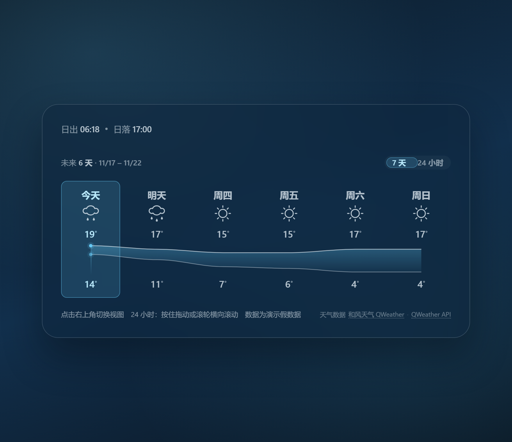
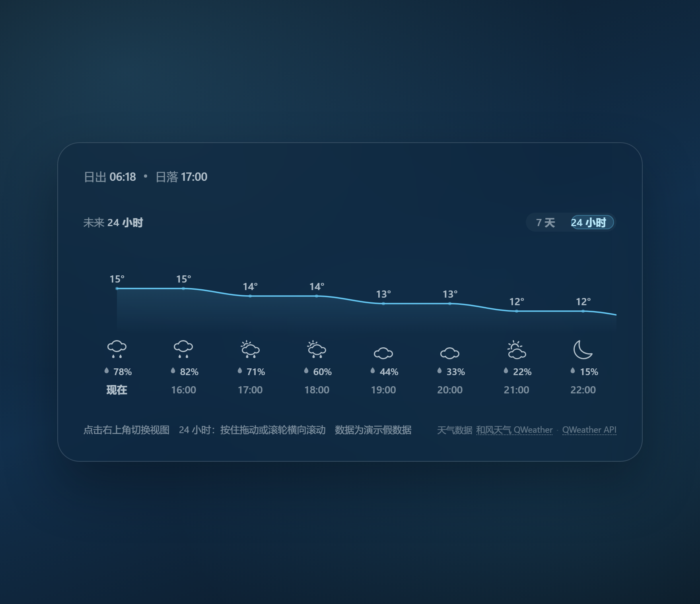
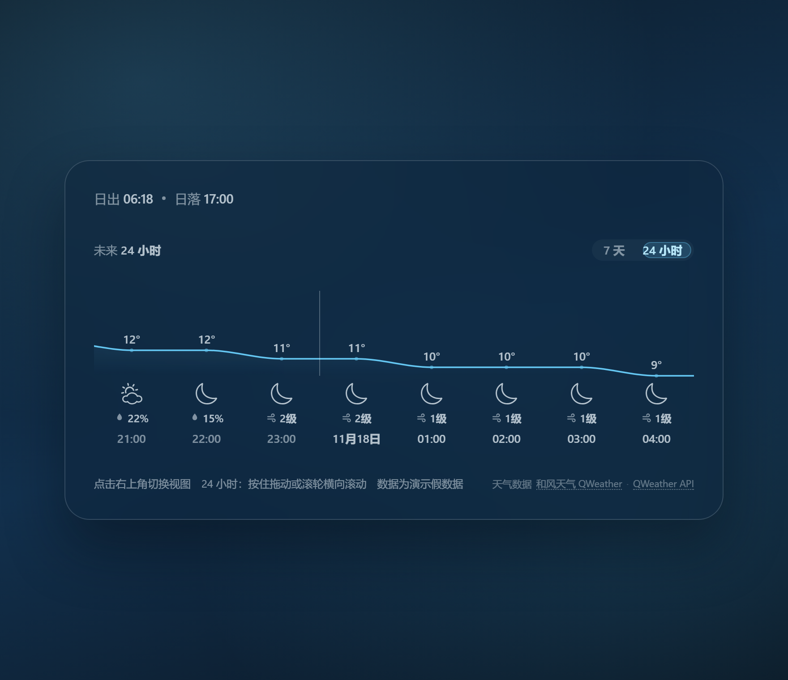
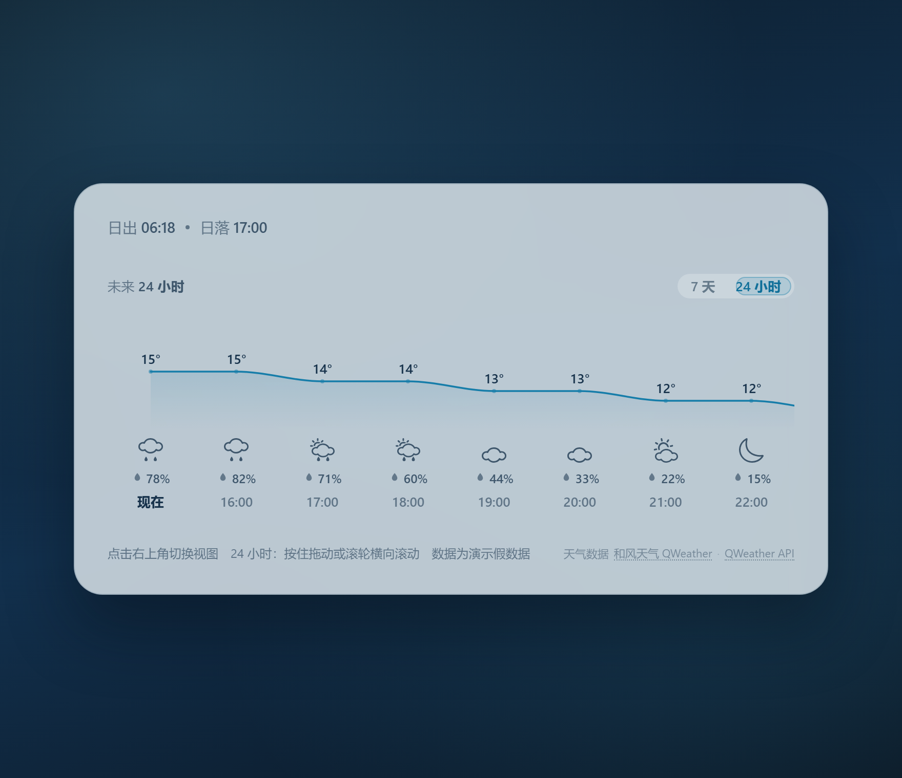

# 预报条：7 日 / 24 小时 双视图切换 · UI/UX 设计路线

> 对象：`WeatherMain.vue` → `.details` 底部的预报条区域（截图红框）
> 目标：这一块支持「7 天」与「24 小时」两种取样方式，共用同一块画布、同一套视觉语言。
> 状态：设计路线 **v2**（已附可交互 demo，见 §14），尚未写实现代码。

---

## 0. 一句话结论

**不做分页、不把 24 小时拆成 8 张卡片**（横向滚动是 v2 采用的做法，最早的否决意见和后来的反转理由都记在 §12）。
在**同一块 12.5625rem 高、约 42rem 宽**的画布上切换两种量程：7 天视图 = 6~7 个「天」列 + 高低温带（可选中一天）；24 小时视图 = **一屏 8 个「小时」列 + 按住拖动横向滚动 + 每列一条温度曲线/一个图标/一个概率或风力/一个时间**（只读，不选中任何列）。切换控件放在预报面板自己的标题行右端。
两条铁律贯穿全文：

| 铁律 | 含义 | 为什么 |
| --- | --- | --- |
| **零交互可读** | 不点、不悬停、不滚动，首屏 8 小时就能读出「何时下雨 / 何时最暖 / 何时转冷」 | 这是壁纸，用户 95% 的时间只是瞥一眼 |
| **同高不跳版** | 两种视图像素级等高（12.5625rem），切换时右侧卡片不发生任何回流 | 壁纸页面上任何跳动都像 bug；也让切换动画可以只做内容层 |

---

## 1. 官方「逐小时天气预报」返回结果解读

接口：`GET https://<apiHost>/weather/v1/hourly/{latitude}/{longitude}`

| 位置 | 参数 | 说明 | 本项目要注意的 |
| --- | --- | --- | --- |
| path | `latitude` / `longitude` | 十进制，**最多两位小数** | `Number(x).toFixed(2)`，不要传原始浮点 |
| query | `hours` | 1–240，默认 24 | 传 `24`（clamp 到区间） |
| query | `localTime` | 默认 `false`（UTC） | **必须传 `'true'`**，与 `get7DayForecast` 保持一致 |
| query | `lang` | 多语言 | 项目未用，忽略 |

返回体：`{ metadata: { tag, attributions }, hours: [...] }`，**没有 `code` 字段**（v1 特性，错误走 HTTP 状态码），所以错误判定依赖 `requestWeather` 已有的 deny 逻辑，不要写 `res.code === '200'`。

### 1.1 `hours[]` 的每一项

| 字段 | 形态 | 归一化动作（复用 `src/api/weather.js` 现有工具） |
| --- | --- | --- |
| `forecastTime` | ISO 串，如 `2024-05-31T03:00Z` | 保留原串作为 **key**；展示用 `clockInZone()` → `3时`；`dateInZone()` 判断是否已跨天 |
| `condition.text` / `condition.code` | 文案 + 图标码 | 图标 `qi-{code}`，与 7 日条同源 |
| `temperature.value` / `.unit` | 数值 + 单位 | `round()` |
| `feelsLike.value` | 体感 | `round()` 归一化后**留在数据里**，但 v2 起不上界面（读数行已删，这一屏只放得下四行） |
| `humidity` | **0~1 小数** | `percent()` → 整数百分比 |
| `wind.direction.degree` / `.compass` | 角度 + 16 方位代码 | `windDir()`（项目内已归一到 8 方位中文） |
| `wind.speed.value` / `.unit` | 多为 m/s | `speedToKmh()` / `round2()` |
| `wind.scale` | 蒲福风级 | 直接展示「2 级」 |
| `windGust.value` | 阵风 | 仅读数里用 |
| `precipitation.amount.value` | 降水量 | `round2()`，单位随 `unit` |
| `precipitation.intensity.value` | 降水强度 mm/h | 本期不用（分钟级降水已覆盖「现在下多大」） |
| `precipitation.probability` | **0~1 小数** | `percent()` → 0~100 整数，**这是 ③ 行降水概率的唯一数据源** |
| `precipitation.type` | `rain\|snow\|ice\|mixed\|none\|unknown` | 与概率一起决定 ③ 行显示「降水概率」还是「风力等级」 |
| `pressure` / `visibility` / `dewPoint` | 数值 + 单位 | 本期不进 UI，先归一化留下（后续做「气压趋势」时不必再改接口层） |
| `cloudCover` | 0~1 小数 | `percent()` |
| `uvIndex` | 0–15 | 已有 `uvScale.js` 可出等级文字 |

### 1.2 五个容易踩的坑

1. **单位小数 vs 百分比**：`humidity` / `cloudCover` / `precipitation.probability` 都是 0~1，直接当 0~100 会得到「0.8% 湿度」。统一走 `percent()`。
2. **`localTime` 默认是 UTC**：不传就是 UTC 串，`clockInZone()` 之后会整体偏 8 小时。
3. **首项不一定是「现在」**：接口给的是「从当前整点开始」的序列，但网络/缓存延迟后首项可能已经是过去时刻。要按「丢弃早于 now−30min 的项」再重新索引。
4. **首项落在当天的 0 时**：如果现在正好是 00:0x，序列 24 项全在「今天」；其余时候第 15 项左右跨零点。**跨零点必须在图上标出来**，否则「0时」在最右端会读成「刚过去」。
5. **`metadata.attributions` 合规**：官方要求数据与来源同时展示。项目里 `normalizeCurrent`（`src/api/weather.js:327`）和空气质量（`:337`、`:357`）都保留了 attributions 字段，但**没有任何 UI 渲染它**。逐小时预报同样要把它随数据带回来（`metadata: { attributions }`），是否在 UI 落位见 §13 开放问题 Q5。

---

## 2. 硬约束（实测，不是估计）

| 约束 | 数值 | 出处 |
| --- | --- | --- |
| 卡片外框 | `min(82vw, 71.25rem)` × `min(46.5rem, 92vh)` | `src/style/weather-panel.scss:27-34` |
| 右栏内容宽 | **≈ 39–42rem**（按 71.25rem 宽、两栏 `0.88fr : 1.6fr`、`padding: 2rem` 反推 ≈ 39.4rem） | `WeatherMain.vue:731` + `dev/forecast.html` 注明 42rem |
| 右栏底部余量 | 正常状态约 **5rem 空白** | `weather-panel.scss` 注释 |
| 7 日条总高 | **12.5625rem**，5 行基线 `1.5 / 2 / 1.5 / 3.5 / 1.5 rem`，`padding-y 0.75rem`，`gap 0.75rem` | `ForecastStrip.vue` |
| 7 日条列宽 | `--fc-col: calc((100% - 6*gap) / 7)` ≈ 6rem | 同上 |
| 现有动效基建 | anime.js `SPRING_PRESETS.slide`、`StaggerTransition preset="trend"/"sunRow"`、`plotKey` 指纹重绘 | `ForecastStrip.vue:225-247` |

**推论：24 列挤在一屏时每列只有 ≈ 1.64–1.75rem（26–28px）。** v1 的所有密度问题都源自这一个数字；v2 的解法是「不改列宽公式，改视口」——一屏只放 8 列（84px），余下的靠横向滚动。

---

## 3. 信息设计：24 小时该回答的 5 个问题

| 用户问题 | 数据字段 | 落在哪一层 |
| --- | --- | --- |
| 现在什么情况 | `condition` / `temperature` / `feelsLike` | 第 0 列 + 读数行 |
| 几小时后会不会下雨 / 什么时候停 | `precipitation.probability` + `type` + 图标 | ③ 行数字（`💧78%`，无雨时换成风力）+ ② 行图标 |
| 温度走势（何时最暖、何时转冷） | `temperature.value` × 24 | 曲线 + 8 个整点温度标注 |
| 风什么时候起来 | `wind.scale` / `speed` | 只在读数行 |
| 天黑没 / 还有多久天黑 | `sunset`、`sunrise`（取自 daily[0]/[1]） | P3 的日落竖标记；本期靠 24h 标签的「明天」提示 |

**取舍：**
- 湿度、气压、能见度、露点、紫外线 **不进 24 小时主图**。它们不是「按小时变化时用户会关心」的量，放进来只会把 84px 的列塞爆。已在接口层归一化保留，将来做「点击小时 → 展开详情」时零成本取出。
- 降水**概率**优先于降**水量**：一小时内「下多大」比「下不下」更难读，而「下不下」才是排期的依据。量放读数行（如「降雨 0.4mm」）。
- **不做「现在」到「+24h」的相对时间轴标签**（+1h、+2h…），一律用绝对钟点（`15时`），因为跨零点后相对轴会失去意义，而绝对钟点天然解释了「明天」。

---

## 4. 布局：与 7 日条共用一套几何（v2）

> **v3 修订（2026-11-17，按第三轮评审意见改）**
> 24 小时视图去掉一切「可选中」的痕迹：**没有选中列、没有高亮块、没有自动滚动（点也不滚）**，退化成一条**只读的曲线带**，靠**鼠标按住拖动**横向滚动。
> 原因：24 列的信息密度已经够高，用户不会逐条细读，选中态只会制造「这一列被特别标出＝它比其他重要」的错觉；而自动跟随会让用户拖动到一半时被抢走滚动位置。改完之后这块唯一的交互就是「拖」，语义干净。

> **v2 修订（2026-11-17，按第一轮 demo 评审意见改）**
> 24 小时视图从 v1 的「24 列挤满一屏 + 8 组标签 + 概率柱 + 第 5 行读数」改为「**一屏 8 列 + 横向滚动 + 每列四行**」，同时删掉概率柱与读数行。
> 原因：24 列塞进 42rem 时每列只有 28px，标签被迫稀疏到每 3 小时（8 组），"逐小时"的信息密度名存实亡；而概率柱和读数行在视觉权重上盖过了真正要看的温度曲线。改成 8 列/屏后每列 84px，标签可以逐小时都给，字号回到 1rem 量级。

### 4.1 几何推导（关键结论：滚动轨道里现有轴公式原样成立）

```html
<div class="hscroll">                                    <!-- overflow-x: auto，视口 = 8 列 -->
  <div class="strip" style="--fc-n:24; --fc-gap-override:0rem; width:calc(100% / 8 * 24)">
```

- 轨道宽度 = 视口 × 3，于是 `--fc-col = 轨道 / 24 = 视口 / 8 ≈ 84px`。
- 曲线画布仍左右各内缩**半列** ⇒ 第 i 个小时的相对横坐标**仍然是 `i / 23`**，贝塞尔控制柄 `(W/(n-1))*0.34`、`clip-path` 进场、`--fc-active` 滑块公式**全部不用改**，`n` 从 7 变 24 而已。
- ⚠️ gap 必须写 `0rem` 而不是 `0`：`calc((100% - (n-1) * 0) / n)` 是「百分比减无单位数」，整条 calc 非法 → `--fc-col` 回落成静态值 → 温度带宽度塌成 0、曲线和柱子一起消失（第一轮 demo 实打实踩过）。

### 4.2 四行结构（每列都完整，高度仍是 12.5625rem）

```
┌─ 标题行  未来 24 小时                                              [7 天 | 24 小时] ─┐
├──────────────────────────────────────────────────────────────────────────────────┤
│ ① 温度曲线   ●─15°─●─15°─●─14°─●  占 5.9375rem（≈ 面板一半高），数值标在点的正上方   │
│ ② 天气图标   ☁      ☁      ☀      ☀                                               │ 1.5rem
│ ③ 💧78%  ≋2级  💧22%  ≋1级   降水概率 与 风力等级 二选一                            │ 0.875rem
│ ④ 现在    16:00   17:00   11月18日  01:00                                          │ 1rem
└──────────────────────────────────────────────────────────────────────────────────┘
   一屏正好 8 列，整条 24 列靠按住拖动横移；每列 84 × 201px，列内没有任何选中态
```

高度账（必须精确等于 12.5625rem，否则切换视图时卡片会跳高）：
`0.875×2（上下留白） + 5.9375（曲线） + 3×0.5（三处行距） + 1.5（图标） + 0.875（概率/风力） + 1（时间） = 12.5625rem` ✓

> 行高要按**真实行盒**给，不按字号拍脑袋：`0.75rem` 的文字在 `line-height: 1` 下占 12px、`0.8125rem` 在 `line-height: 1.2` 下占 15.6px。第一版按字号给了 `1.25rem / 1.125rem` 两行，列高直接涨到 211px，超出 10px 把卡片顶高了。

| 行 | 内容 | 规则 |
| --- | --- | --- |
| ① | 温度曲线 + 每点数值 | 24 点三次贝塞尔 + 线下渐变面积；数值用 `top: calc(var(--fc-band-top) + var(--fc-band) * var(--p))` 绝对定位在点上方的固定距离；**整条带无选中态**，所有列视觉权重相同 |
| ② | 天气图标 | `qi-{code}`，**1.5rem**——和文字同一量级，不再是压住整列的「大图标」 |
| ③ | 降水概率 **或** 风力等级 | `probability ≥ 0.1` → `💧 + 整数百分比`；否则 → `≋ + 风力等级 "2级"`。两个数字挤在一格谁也读不清，所以二选一 |
| ④ | 时间 | `现在` / `HH:00` / 跨零点那一格写 `11月18日`。日期本身就是分隔标记，v1 那个额外的「明天」小字可以删掉 |

### 4.3 图层（沿用 7 日条的分层约定，但少两层）

```html
<div class="hscroll">                          <!-- z 自身：横向滚动容器，一屏 8 列 -->
  <div class="strip" style="--fc-n:24; --fc-gap-override:0rem; width:calc(100% / 8 * 24)">
    <svg  class="strip-plot"  />               <!-- z1 温度曲线 + 线下渐面积 + 温度数字 -->
    <div class="strip-cols">                   <!-- z2 24 个 <li>，承载②③④三行 -->
  </div>
</div>
```

与 7 日条相比**没有** `strip-thumb`（选中列底色）和 `strip-frame`（选中列描边）——24 小时视图不选中任何一列，这两层直接不存在。

`strip-plot` 必须 `aria-hidden="true"`，另配视觉隐藏的文字摘要（见 §8）。

### 4.4 曲线画法（v2：只留一条温度曲线）

| 元素 | 规格 |
| --- | --- |
| 温度曲线 | SVG `<path>`，24 点三次贝塞尔平滑（沿用 `handle = (700/(n-1))*0.34`）；`stroke: var(--color-primary)`、`stroke-width: 1.75px`、`vector-effect="non-scaling-stroke"` |
| 面积 | 同 path 闭合到带子底线，`linear-gradient(currentColor 28% → 12% @45% → 0 @100%)`；**必须淡到全透明**：收尾留 2% 不透明度时，带子底边会在渐变末端切出一条硬横线，看着像图表被裁掉一截 |
| 值域 | **严格取这 24 项 `temperature.value` 的最高/最低**：`top = max`、`span = max - min`，最高点贴温度带顶部、最低点贴底部，不留 pad（`padRatio = 0`）。⚠️ 不要用 `daily` 的 `tempMax/tempMin`——那是整天的极值，24 小时窗口跨零点时两者不相等，画出来的振幅是假的；只有本序列的极值才是「曲线的最高/最低温度」 |
| 数字避让 | 数字默认画在点上方 0.375rem；当 `y < 21%`（顶部没有上方空间）时给该列加 `.is-below`，数字改画在点下方——否则最高那一两列的字会顶出温度带 |
| 描边裁切 | 曲线贴到带子上下边缘后，`stroke` 有一半在盒外；`.trend` 要 `overflow: visible` + `clip-path: inset(-2px)`（进场动画同款 -2px），否则最高/最低那一段会被切平。**只给 24 小时视图加 `.is-bleed`**，7 日视图保持 `inset(0)`，否则像素级对比会出现 2px 差异 |
| 温度数字 | `0.8125rem / 600`，绝对定位在点正上方 `0.375rem`；点 = `0.25rem` 圆点、`opacity: .5`。**不做选中变色**——整条带所有数字同一层级 |
| 跨零点 | 一条 `1px` 淡竖线落在 0 时那一列（写 `11月18日` 的那格）的**左边界** `calc(var(--fc-col) * 9)`，高度 = 曲线带高度 |
| **不画** | 概率柱、50% 参考虚线、第 5 行读数行 —— v1 的三样东西全部删除 |

### 4.5 横向滚动（v3 唯一的交互）

| 行为 | 规格 |
| --- | --- |
| 视口 | 一屏正好 8 列；`scrollbar-width: none` + `::-webkit-scrollbar { display: none }`（壁纸里滚动条是噪声），靠内容被裁切来暗示「还有」 |
| 拖动 | **鼠标按住拖动是主要方式**，用仓库里已装的 `@better-scroll/core`（`scrollX: true, scrollY: false, bounce: false, eventPassthrough: 'vertical', disableMouse: false`）驱动 `transform`，自带惯性；容器 `cursor: grab`，拖动中 `grabbing`。`eventPassthrough: 'vertical'` 保证纵向滚轮仍然能滚页面，不会被这块吃掉 |
| 整列吸附 | 松手（BetterScroll 的 `scrollEnd`）后吸附到**整列**：`k = round(currentLeft / col)`、`scrollTo(-col*k)`。**必须有**：自由停止会停在半列上，视口左右各露半列，一屏就不止 8 条了（实测 7 整 + 2 半），而「一屏 8 小时」是这个视图唯一的信息密度承诺 |
| 滚轮 | 鼠标滚轮**一格走一列**（`deltaY` 取符号 → `k = round(currentLeft / col) + dir`，140ms 内只响应一次）。桌面用户只有滚轮时，不映射会以为「这块点不动」；而逐像素跟随 `deltaY` 会在吸附时被来回纠正，看着像抽搐 |
| 不做自动滚动 | **点击不滚、悬停不滚、没有「选中即居中」**。v2 的 `revealHour()` 整段删除；用户自己拖到哪就是哪，程序不再抢滚动位置 |
| 切换视图时 | 切到 24 小时只做一次 `ensureScroller()`（惰性建实例，视图 `display:none` 时容器宽度是 0，建了也白建），保留上次的滚动位置 |
| 兜底 | `window.BScroll` 不存在或初始化抛错时，退回手写 pointer 拖动（`pointerdown/move/up` + `setPointerCapture`，松手同样吸附整列），并在 console 里 warn 一次 |

### 4.6 纵向节奏（这版专门调过）

一列内五段自下而上是「时间 → 读数 → 图标 → 图」，节奏必须等距，否则曲线和图标会黏在一起：

| 间距 | 值 | 说明 |
| --- | --- | --- |
| 上留白 | `0.875rem` | 曲线贴顶时，最高点的数字（13px）还要放得下 |
| 图 ↔ 图标 | `0.5rem` | v2 只有 `0.25rem`，实测图标贴着曲线底边，像图表压在图标上 |
| 图标 ↔ 读数 | `0.5rem` | 与上一处同值，避免「图标独占一组」的错觉 |
| 读数 ↔ 时间 | `0.5rem` | 同上 |
| 下留白 | `0.875rem` | 与上留白对称 |

---

## 5. 交互模型

### 5.1 切换控件：位置与形态

**推荐方案 B：预报面板自己的标题行（右端）** —— ⚠️ 落地时改用了方案 A：右侧这一列实测只剩 7px 余量，标题行的 2.1rem 会把 7 天条最后一行温度顶出卡片，详见 §15.2。

```
未来 24 小时                                            ╭───────────╮
                                                    │ 7 天 │24 小时│
                                                    ╰───────────╯
```

- 成本：**+1.5rem 高度 + 0.625rem 内间距 ≈ 2.1rem**，来自右栏底部那 5rem 空白，不挤占任何现有内容。
- 收益：控件紧贴它控制的东西；标题行左侧本就该有「这块是什么时间范围」的说明（现在这块完全没有），24 小时视图左侧只写「未来 24 小时」——跨天信息交给 ④ 行的日期那一格承担，标题行不再重复（v1 里重复写过，被用户划掉了）。
- 语义：面板自己持有视图状态，标题行归面板所有，不侵入 `.sun-row`。

**备选方案 A（空间吃紧时）：挂在 `.sun-row` 同一行右端**（✅ v3 最终采用）
`.sun-row` 是 `inline-flex` 左对齐，右侧本来空着，包一层 `display:flex; justify-content:space-between` 即零高度成本。缺点是「日出日落」和「视图切换」挤一行，语义混搭；如果将来 sun-row 要加内容（月相、空气质量）就会打架。

**控件形态**（两种方案通用）：

| 属性 | 值 |
| --- | --- |
| 结构 | `role="tablist"` + 两个 `role="tab"`（`aria-selected`、`aria-controls`），胶囊底槽 `height: 1.5rem`、`padding: 0.125rem`、`border-radius: 999px`、`background: var(--glass-bg-subtle)` |
| 段 | `padding: 0 0.625rem`，`font-size: 0.8125rem`，`font-weight: 600`，未选中 `var(--text-muted)` |
| 选中态 | 滑块层（不是给按钮换背景）：`background: var(--glass-active)`，`border: 1px solid color-mix(in srgb, var(--color-primary) 35%, transparent)`，文字 `var(--color-primary-soft)` |
| 滑块动效 | `SPRING_PRESETS.slide`，与 7 日条的选中浮层同一套手感 |
| 键盘 | ←/→ 切换并把焦点移到新 tab，Home/End 到首/尾；不用 div 冒充按钮 |
| 焦点 | 全局 `:focus-visible { outline: 2px solid var(--color-primary) }`（`src/style/index.scss:362`）已覆盖，勿覆盖掉 |
| 文案 | 「7 天」「24 小时」（不写「日/时」，避免与「今天 19°/14°」里的日混淆） |

### 5.2 选中模型（两种视图各自独立，互不干扰）

| 视图 | 选中单位 | 默认 | 影响范围 |
| --- | --- | --- | --- |
| 7 天 | 一整天（现有 `activeDate`） | 今天 | 联动顶部日期、6 张指标卡、日出日落 |
| 24 小时 | **无选中**（只读曲线带） | — | 不影响任何地方；唯一的交互是按住拖动横移 |

**为什么 24 小时彻底不要选中**：v2 里「选中一小时」还带着滑块、列内变色、自动滚动三件事，但这一屏的信息密度已经高到用户不会逐条读，选中态反而在暗示「这一列比别的列重要」；而自动跟随会在用户拖到一半时把滚动位置抢回去。v3 把这一整层砍掉之后，语义只剩「看趋势」，也省掉了 `aria-pressed`、roving tabindex、键盘导航一整串无障碍负担。

**7 天的选中照旧**：它是原有行为——点一列会把顶部的日期、6 张指标卡、日出日落换到那一天。两套视图的交互模型**故意不一样**：7 天是「选一天看详情」，24 小时是「看一条曲线」，不要把 7 天的选中硬套到 24 小时上。

### 5.3 状态机

```
daily ──tab──▶ hourly(候选) ─ensureHourly()─▶
  ├─ 命中缓存 ─────────────▶ hourly(ready)
  ├─ 请求中 ───────────────▶ hourly(loading)  曲线带骨架（一条 1px 虚线）+ 图标/信息/时间三行骨架胶囊
  └─ 失败 ─────────────────▶ hourly(error)    曲线带中央「加载失败，点击重试」（真按钮，可 Tab 聚焦）
hourly ──tab──▶ daily（保留滚动位置，下次切回原样）
```

- **懒加载**：首次切进 24 小时才发请求。壁纸用户里相当一部分从不切换，不该为此多花配额。
- **首次之后纳入主节拍**：`useWeatherRefresh` 的 60s 主循环里带上 hourly（`useWeatherRefresh.js:56`），命中 TTL 就直接早退，不会多打请求；不需要另开节拍，也不需要改 `useWeatherRefresh`。
- **默认视图 = 7 天**：老用户升级后看不到任何变化（`useStorage` 默认值 `'daily'`）。

---

## 6. 动效规格

| 场景 | 规格 | 备注 |
| --- | --- | --- |
| 视图切换 | 出 120ms（opacity 1→0，translateX ∓8px）→ 入 200ms（0→1，±8px），方向由目标视图在左/右决定；`<Transition mode="out-in">` | 容器高度锁定 12.5625rem，动画期间整体不位移 |
| 曲线进场 | 复用 `plotKey` 指纹（`首项 forecastTime + 24 个温度拼接`）+ `revealKey`（视图切入/数据从空到有）→ `StaggerTransition preset="hourlyTrend"` 的 `clip-path` 左→右（**1440ms**，base 120ms，**离场 0ms**；按「笔速」定，见 §15.9、§15.11） | 与 7 日条数据刷新时的观感一致，用户不会觉得是两套东西 |
| 列错峰进场 | `StaggerGroup preset="hourlySlot"`：420ms、base 120ms、step 16ms、maxDelay 220ms（整片 760ms 收干净） | step 比 7 日条的 44ms 小得多，否则最后一列会晚于曲线画完 |
| 跨零点竖线 | `StaggerTransition preset="hourlyDivider"`：420ms、base 700ms（等列落位、曲线画过半夜那一列再出现） | 它标的是「新的一天从哪列开始」，不能抢在数据前面 |
| 概率柱进场 | ~~v2 已删除概率柱~~ | — |
| 拖动惯性 | BetterScroll 自带的减速（`momentum`）；`prefers-reduced-motion` 或 `?static=1` 时关掉惯性，松手直接吸附 | 惯性是「手感」，不是「装饰」，但它会让晕动症用户不适，所以要能被关掉 |
| 吸附回弹 | 松手到整列：`scrollTo(-col*k, 0, 240ms)`；`prefers-reduced-motion` 时 `0ms` 瞬移 | 距离已 <1px 时不动，避免拖完再微抖一下 |
| **不做** | 没有「选中滑块」也没有「滚动跟随」——24 小时视图不选中任何列（见 §4.5） | 7 天视图的选中滑块与弹簧照旧 |

**可中断要求**：所有动画句柄存 ref，切换/连续点击前 `previous?.cancel()`，**状态落定不得依赖 `transitionend`**（动画被打断时该事件不会来，视图就会卡在半透明）。

---

## 7. 视觉规格（全部用现有 token，不新增硬编码色值）

| 用途 | 值 |
| --- | --- |
| ① 温度数字 | `0.8125rem / 600`，`font-variant-numeric: tabular-nums`；全部 `var(--text-primary)`（无选中，不做层级差）；缺数据 `—` 不带度符号（与 7 日条一致） |
| ① 曲线 | 见 §4.4；描边 `var(--color-primary)` 1.75px，面积 28%→12%→0 三段渐变 |
| ② 天气图标 | `1.5rem`（= 1.5 倍字号，与文字同一量级；7 日条是 2rem，因为那里是主角） |
| ③ 概率/风力 | `0.75rem / 600`，`var(--text-secondary)`；小图标 `0.75rem`、`opacity: .7`，与数字基线对齐 |
| ④ 时间 | `0.8125rem / 600`；普通 `var(--text-muted)`，`现在` `var(--text-primary)`，跨天那格（`11月18日`）`var(--text-secondary)` 并略加字距 |
| 拖动手感 | 容器 `cursor: grab`、拖动中 `grabbing`；**列不设 `cursor: pointer`**（不是可点的东西，别给出可点的暗示） |
| 跨零点分隔 | 1px 竖线 `var(--glass-border)`，只贯穿曲线带高度（不穿过图标/文字行，避免切断整列） |
| 滚动条 | 隐藏（`scrollbar-width: none` + `::-webkit-scrollbar{display:none}`），靠第 8 列被裁切暗示可滚动 |
| 数据来源署名 | `0.6875rem`、`var(--text-muted)` + `opacity: .75`；链接用虚线底边 `border-bottom: 1px dotted currentColor`，hover 提到 `var(--text-secondary)`；落在脚注行右端、与左侧提示同一基线 |
| 浅色主题（`mist`） | 曲线面积透明度提到 `.34`（浅底上 28% 太淡）；文字色仍走 token，无需特判 |

---

## 8. 无障碍

| 项 | 做法 |
| --- | --- |
| 24 列不是控件 | 24 小时视图**没有可点元素**：列是 `<li>`，不带 `aria-pressed`、不带 `tabindex`、不进 Tab 序列（v3 去掉了选中模型）。语义是「一张图 + 24 条标注」，`role="group"` + `aria-label="未来 24 小时温度趋势"` 就够了 |
| 滚动容器 | `<div class="hscroll">` 本身**不设** `tabindex`；键盘用户的横向滚动交给浏览器默认行为（`Shift + 滚轮`/触控板），不抢方向键 |
| 图表层 | `aria-hidden="true"`；另给一段视觉隐藏摘要（`aria-live="off"`）：「未来 24 小时，最高 19 度（明天 14 时），最低 9 度（明天 5 时）；降水概率最高 82%（16 时）」——图不看也能拿到全部结论 |
| 目标尺寸 | v2 的 84 × 201px 与 44×44 的关系不再是「点击目标」问题（v3 没有点击）；但它保证 8 列仍然清晰可读，字号不被压缩 |
| 动效 | `prefers-reduced-motion` 下：无位移、无绘制、无惯性、吸附瞬移、骨架改为静态占位 |
| 拖动不会吃掉纵向滚动 | BetterScroll 的 `eventPassthrough: 'vertical'`：纵向手势继续滚页面，只有横向手势归这块 |

---

## 9. 边界与降级

| 场景 | 处理 |
| --- | --- |
| 首项早于 now−30min | 丢弃过期项后重新索引；标签写实际钟点（`15:00`）而非「现在」 |
| 序列不足 24 项 | 按实际项数渲染（`--fc-n` 动态），轨道宽度改 `calc(100% / 8 * n)`，不补齐假数据 |
| 跨零点 | 0 时那一格的时间写日期（`11月18日`）而不是 `00:00`，并在**这一格的左边界**画一条淡竖线（`left: calc(var(--fc-col) * 9)`，只贯穿曲线带高），标出「新的一天从这里开始」 |
| 字段缺失 | 温度 `—`；图标 `qi-unknown`；③ 行：概率缺失且无风力 → 只留图标，不写占位文本 |
| 请求失败 | 保留 24 小时布局，曲线带中央「加载失败，点击重试」（真 `<button>`），下个主节拍自动重试；**不自动弹回 7 天**（会显得控件失灵） |
| 时区 | 一切时间/日期换算走 `formatInZone` / `clockInZone` / `dateInZone` + 查询地 `tz`，禁用 `new Date().getHours()` |
| 壁纸属性 5/6/7 天 | 只影响 daily 视图；hourly 固定 24 项（48 小时档位见 §11 P3） |
| 换城市 / 换凭据 | 沿用 `isFresh` 的指纹 + 版本判定；hourly 的更新时间戳独立，失败**不推进时间戳**（与生活指数 v7 的教训一致） |

---

## 10. 工程落地清单

### 10.1 数据层

**`src/api/weather.js`**
- `API_BY_PATH`（:29-37）末尾追加 `[/^\/weather\/v1\/hourly\//, 'hourly']`；并在 `src/api/requestStats.js:69` 的 `REQUEST_API_LABELS` 里补 `hourly: '逐小时预报'`（否则统计面板会把新接口显示成 `other`）；顺带更新 `requestStats.js:254` JSDoc 里的代号列举。
- 新增：
  ```js
  export const normalizeHourly = (raw, timeZone) => ({ /* forecastTime, hourLabel, dayOffset,
     icon, text, temp, feelsLike, humidity, windDir, windScale, windSpeed, gust,
     precipProb, precipAmount, precipType, pressure, visibility, cloud, uvIndex, dewPoint */ })

  export const getHourlyForecast = ({ lat, lon, tz }, hours = 24) => requestWeather(
    `/weather/v1/hourly/${Number(lat).toFixed(2)}/${Number(lon).toFixed(2)}`,
    { hours: clamp(hours, 1, 240), localTime: 'true' },
    'hourly'
  )
  ```
  返回值保持与现有 `get7DayForecast` 同形：`{ hours: normalizeHourly(...), metadata: { attributions } }`。
- 复用工具：`percent()`(:90)、`round()`(:88)、`windDir()`(:134)、`clockInZone()`(:168)、`dateInZone()`(:164)、`speedToKmh()`(:96)。

**`src/config/weatherCache.js`**
- `WEATHER_CACHE_SPECS` 增加：`hourly: { ttl: 30 * 60 * 1000, recommended: [30, 60], updateFrequency: 60, envKey: 'VUE_APP_WEATHER_UPDATE_HOURLY', crossLocalDay: true, label: '逐小时预报' }`
  —— 官方「缓存 30–60 分钟、更新频率 60 分钟」取区间下界 30min：最坏陈旧度 = 30 + 60 = 90min，仍在「2 倍」容忍内。
- `crossLocalDay: true`：跨本地零点后首项会变成「昨天的 15时」，必须整块作废。
- 文件头注释表把「逐小时预报 ——（未使用）」改为实际使用的时长。
- **`vite.config.js:56-63` 的 `CLIENT_ENV_KEYS` 要加 `VUE_APP_WEATHER_UPDATE_HOURLY`**，否则 `.env` 覆盖静默失效（该文件注释已警告过这个坑），同时补 `.env.example`。

**`src/features/weather/useWeatherStore.js`**
- `import { getHourlyForecast as getHourlyForecastAPI }`
- 新增 `HOURLY_COLUMNS = 24`、`HourlyWeatherData = ref([])`、`HourlyStatus = ref('idle'|'loading'|'ready'|'error')`、`WeatherDataUpdatedAtATime.value.hourly`
- `getHourlyWeatherData(force = false)`：`singleFlight('hourly:' + key, ...)`；`isFresh('hourly', at, force)` 命中直接返回；成功后写数据 + 时间戳；失败写 `HourlyStatus='error'` 且**不动时间戳**
- 主 `refresh()`（:362 的 `Promise.allSettled`）里按 `HourlyEverRequested` 门闩决定是否带上 hourly
- persist `paths`（:946）追加 `HourlyWeatherData` 与时间戳；**不要把 `HourlyStatus` 持久化**

### 10.2 视图层

| 文件 | 动作 |
| --- | --- |
| `src/style/forecast-grid.scss`（新，或并入 `weather-panel.scss`） | 抽出两边共用的 `.strip` 5 行网格与 `--fc-n/--fc-gap/--fc-col/--fc-active/--fc-text/--fc-pad-y/--strip-h`，**保证等高**是这份文件的唯一职责 |
| `ForecastStrip.vue` | 仅把网格/变量改为引用共享 scss；行为逻辑（滑块、`plotKey`、StaggerTransition）零改动 |
| `ForecastPanel.vue`（新） | 持有 `view`（`useStorage('WeatherForecastView','daily')`）；渲染标题行 + 控件 + `<Transition>` + 两个子视图；负责骨架/失败态。**不持有任何小时选中状态** |
| `ViewSegmentedControl.vue`（新） | `role="tablist"` 两段控件 + 弹簧滑块；props `modelValue`、`options`；emit `update:modelValue` |
| `HourlyStrip.vue`（新） | 横向滚动容器（BetterScroll，`@touch`/`@wheel` 之外的拖拽交给库）+ 24 个只读列 + SVG 曲线，props `hours`、`status`；emit `retry`；内部只有 `snapToColumn()` 与滚轮映射，**没有 `revealHour`** |
| `WeatherMain.vue` | `<ForecastStrip :days …/>` → `<ForecastPanel :days="forecastDays" :active-date="activeItem" @select-day="activeItem = $event" />`；`activeItem` 逻辑不变 |
| `src/dev/hourly.html` + `src/dev/hourlyPreview.js`（新） | 照 `forecast.html` 的结构，挂在 `.preview-details { width: 46rem; padding: 2rem }` 里；支持 `?view=`、`?n=`、`?at=`、`?theme=`、`?loading=1`、`?error=1` |

> `vite.config.js` 只有 `index.html` 一个入口，`src/dev/*.html` 靠 dev server 直接访问（现有 `forecast.html` 即如此），**不需要改构建配置**。

### 10.3 数据署名（合规章节，Q5 已定案）

Q5 已定案：**保留字段 + 设置面板落位 + 主界面脚注一行最淡署名**。理由是 v1 接口每个响应都带 `metadata.attributions`（`[{ name, url }]`），官方要求「数据与来源同时展示、且可点」，而壁纸主界面是「一眼看完」的面板，不该塞一整块链接——所以两个位置各承担一半职责：脚注负责**看得见的合规**，设置面板负责**点得进去的详情**。

- 数据层：`{ hours, metadata: { attributions } }` 原样带回 store，**不要在 `normalizeHourly` 里丢掉**。
- 脚注层：`.card-foot` 右端一句 `天气数据 和风天气 QWeather · QWeather API`，`0.6875rem`、`opacity: .75`、虚线底边，`target="_blank" rel="noopener noreferrer"`。
- 设置面板「关于 / 数据来源」：遍历**当前生效**的 `attributions[].name` 并链接 `url`。注意空气质量、天气预警各有自己的 attribution，不能只写一个和风天气。

demo 已按脚注形态落地（`docs/design/demo/forecast-switch.html` 的 `.card-foot`）：实测 `hint` 412.2px + `credit` 225.1px 在 670px 可用宽里同一行放下，不换行。

### 10.4 全局：拖动不选中文本（已落地 `src/style/index.scss`）

壁纸里几乎全是「按住拖动」的手势（拖预报条、拖曲线、拖面板），一旦把文字选蓝，Windows / Edge 会弹出「搜索所选内容」「添加批注」浮条，原生选中拖拽还会带出半透明 ghost。这不是单个组件的问题，所以修在全局样式里：

```scss
html {
  -webkit-user-select: none;
  user-select: none;
  -webkit-tap-highlight-color: transparent;
}
img, svg { -webkit-user-drag: none; user-drag: none; }
[data-selectable], input, textarea, pre, code {
  -webkit-user-select: text;
  user-select: text;
}
```

要点：

- `user-select` 是**可继承**属性，写在 `html` 上就够，不必逐组件加；组件里若写 `user-select: auto` 会跟随父级（仍是 none），不会被意外重置成可选。
- 例外只留三类：输入框、代码块、显式标了 `data-selectable` 的元素。设置面板里的城市搜索框必须能选中文字，否则用户改不了输入。
- `-webkit-user-drag: none` 是另一半：只禁选中、不禁原生拖拽时，拖动图标仍会拖出 ghost 并触发 `drop`。
- `-webkit-tap-highlight-color: transparent` 顺手去掉触屏拖动时那层灰色高亮块。
- 实测（demo，headless 读 `getComputedStyle`）：`body` / 列内文字 / 标题行都是 `user-select: none`，临时插入的 `<input>` 是 `text`——例外生效、继承链没被破坏。

---

## 11. 实施路线（每阶段都可独立验收）

| 阶段 | 内容 | 工时估 | 验收标准 |
| --- | --- | --- | --- |
| **P0 几何先行** | 预览页 + 假数据 + `forecast-grid.scss` + `HourlyStrip` 静态结构 | 1 天 | `dev/hourly.html` 在 46rem 下无横向溢出；`getBoundingClientRect().height` 与 7 日条**完全相等**；`?n=` 换成 6/7 天数据也不塌 |
| **P1 数据通路** | `normalizeHourly` + `getHourlyForecast` + 缓存 spec + store + `.env` 链路 | 1 天 | 预览页用真实响应渲染；0~1 百分比全部显示正确；跨零点标签正确；连续刷新命中缓存（Network 面板只 1 次请求 / 30min） |
| **P2 切换** | `ForecastPanel` + `ViewSegmentedControl` + 过场 + 懒加载/骨架/失败重试 + `useStorage` 持久化 | 1 天 | 来回切换 20 次高度零抖动；重载页面记住上次视图；reduced-motion 下无动画；快速连点不出半透明残留 |
| **P3 滚动与动效** | BetterScroll 拖拽 + 整列吸附 + 滚轮映射、曲线绘制 + 温度数字 + 纵向节奏、文字摘要 | 1.5 天 | 按住鼠标能拖动且松手停在整列上；滚轮一格一列；**点/悬停都不抢滚动位置**；屏幕阅读器能读出完整摘要 |
| **P4 增强（可选）** | 夜间底纹（daily[0]/[1] 的日出日落）、日落竖标记、体感温度副线、48 小时档位、壁纸属性 `forecastview` | 1–2 天 | 每项独立开关，缺数据时静默不画 |
| **P5 收尾** | attributions 落位、README/可访问性说明、视觉回归截图（三套主题 × 两种视图） | 0.5 天 | 三主题下颜色对比达标；截图归档 |

---

## 12. 备选方案与决策记录

| 备选 | 为什么否决 |
| --- | --- |
| **24 小时横向滚动**（v2 采用） | ~~v1 否决过，v2 反转~~。v1 的理由是「内容要装进视口宽 + 滚动条噪声」，但实测下来 24 列硬塞只有 28px/列，标签必须稀疏到每 3 小时，反而更不像「逐小时」；隐藏滚动条 + 一屏 8 列 + 按住拖动之后，「零交互可读」仍然成立（首屏就是最近的 8 小时）。**决策反转的理由记在这里，避免以后有人再按 v1 的理由改回去** |
| **分页（3 页 × 8 小时 + 箭头）** | 保留列语言和 44px 目标，但一次只能看 1/3 数据，还要第二组控件（页码/箭头）来解释第一组控件；滚动是「连续」的，分页是「跳变」的，后者会让温度曲线在页边界处断开 |
| **24 个完整列挤满一屏（v1 方案）** | 28px 的列放不下三个字，只能把字号降到 12px 以下——切换时字会缩水，破坏「同一个仪表」的观感，也低于正文可读下限 |
| **每 3 小时一组标签（v1）** | 8 列/屏之后这条约束消失了：每列 84px 装得下 `16:00` 与 `11月18日`，标签逐小时都给 |
| **把 24 小时做成 8 张卡片（Bento 风格）** | 卡片意味着边界，24 个连续小时被切成 8 段后，「趋势」这个最重要的信息就没了；且 8 张卡在 12.5rem 高里只能放很小的字 |
| **切到 24 小时时同步更新顶部 6 张指标卡** | 指标卡带「与前一天的差」角标，语义属于「整天」；改成小时会让角标变成谎言，且是一次高风险的跨组件耦合 |
| **另开一个独立面板/弹窗展示 24 小时** | 壁纸不能有「必须点开才看得到」的核心信息；弹窗还会盖住左侧「现在」那张很有价值的卡片 |
| **保留降水概率柱 + 第 5 行读数（v1）** | 用户评审时直接划掉：24 条信息的密度已经足够，读数行是「中间层」；概率柱在视觉权重上压过了温度曲线。概率改成 ③ 行的一个数字（`💧78%`），与风力二选一 |
| **24 小时列可选中（v1/v2）** | 第三轮评审明确要求去掉：不选中任何一列、点击也不滚动。理由见 §5.2——密度已经够高，选中态反而制造「这列更重要」的错觉，自动跟随还会在拖动中途抢滚动位置 |
| **自己写横向拖动** | 仓库里已经装了 `@better-scroll/core`（壁纸工程原本就有），拖拽惯性、边界回弹、`eventPassthrough` 都是它的强项；手写 pointer 方案只保留为「库没加载成功」的兜底。不要为了少一个依赖去手写惯性，实测手写版本在快速甩动时手感明显更差 |
| **用原生 `scroll-snap` 做吸附** | 与 BetterScroll 的触摸/惯性体系会打架（两条滚动状态源互相纠正）；吸附改在 `scrollEnd` 里一次性 `scrollTo(-col*k)`，落点确定且可测 |
| **让浏览器自己管文本选中** | 壁纸没有需要复制的正文，却要承担选中文本带来的搜索浮条和拖拽 ghost；而且这是全局行为，只在组件里加会漏掉下一个可拖区域 |
| **attributions 只存进数据、不上界面** | 官方要求「数据与来源同时展示」，只存不显示等于没做合规；但主界面也不该出现一整块链接，所以拆成「脚注一行 + 设置面板详情」 |
| **「重播型」动画给一段离场时长（曲线）** | 用 `:key` 换节点来重播，Vue 必然给旧节点跑一次离场；`.stagger-leave-active` 是 `position: absolute; inset: 0`，旧的完整曲线会正好糊在新曲线（还被 `clip-path` 藏着）上淡出，观感变成「先看到一条完整的线 → 淡掉 → 才开始画」。重播型动画（曲线/进度条）的离场时长一律 **0**，见 §15.11 |

---

## 13. 需要你拍板的事（v3 已收敛 4 项）

| # | 问题 | 状态 / 我的建议 |
| --- | --- | --- |
| Q1 | 切换控件位置：面板自己的标题行（+2.1rem，语义清晰）还是 `.sun-row` 右端（零高度，语义混搭） | **设计上选标题行，落地时改用 `.sun-row` 右端**：右栏只剩 ~7px 余量，2.1rem 的标题行会把 7 天条顶出圆角（实测 `scrollHeight 350 > clientHeight 336`），见 §15.2 / §15.6 |
| Q2 | 标签密度：8 组（每 3 小时）/ 12 组（每 2 小时）/ 逐小时 | **已定案：逐小时**（横向滚动让每列 84px，24 个标签全部画得下） |
| Q3 | 默认视图是否保持 7 天 | **保持**，老用户零感知 |
| Q4 | 24 小时要不要「选中某个小时」 | **已定案：完全不要**（第三轮明确要求去掉高亮块与点击/自动滚动，见 §5.2 与 §4.5） |
| Q5 | `metadata.attributions` 放哪：设置面板「数据来源」/ 24 小时标题行右侧极淡文字 / 暂不展示但保留字段 | **已定案：保留字段 + 设置面板落位 + 主界面脚注一行最淡署名**（见 §10.3，demo 已实现） |
| Q6（新） | 是否把「24 小时」做成 48 小时档位（`hours=48`，5 屏 × 8） | 先不做；接口支持到 240 小时，将来加 `48` 档位不用改几何，只是轨道宽度 `calc(100% / 8 * 48)` |

现在只剩 **Q3 / Q6** 两项待你点头。确认后我按 P0 → P5 推进，P0 交付时会附 `dev/hourly.html` 预览页与两种视图的等高对照截图。

---

## 14. 可交互 demo（v3 实物对照）

`docs/design/demo/forecast-switch.html` —— 单文件、双击即开，只包含「日出日落 + 预报条」这一块区域，用来验证第 4/5/6 节的几何与交互假设。横向滚动用的是仓库里已装的 `@better-scroll/core`（UMD 构建，两个 `<script src>` 直接从 `node_modules` 引，file:// 下也能加载）。

### 14.1 参数

| 参数 | 作用 |
| --- | --- |
| 无参数 | 7 天视图，点右上角「7 天 / 24 小时」切换 |
| `?view=hourly` | 直接打开 24 小时视图（截图 / 评审用） |
| `?at=6` | 打开时直接滚到第 6 列（= 21:00），用来截跨零点那一屏 |
| `?theme=mist` | 浅色 mist 主题，验证 token 只换变量不改结构 |
| `?static=1` | 关掉所有进场动画，取稳定终态截图（headless 截图必带） |
| `?debug=1` | 把关键盒子的 `getBoundingClientRect()` 与 BetterScroll 状态打到页面上（排查几何 / 滚动用） |

### 14.2 四张对照图

| 7 天视图 | 24 小时视图（首屏） |
| --- | --- |
|  |  |
| 高度 12.5625rem，保留选中列高亮 | 高度 12.5625rem（像素级等高），无任何选中态 |

**24 小时视图 · 拖到跨零点处（`?at=6`）**



**24 小时视图 · 浅色主题（`?theme=mist`）**



这三张图专门看四件事：一屏是 8 个**完整**小时（不会露半列）；日期那一格替代 `00:00` 同时承担分隔职责，竖线画在它的**左边界**；值域贴边后夜间 12°→9° 的落差是真实振幅（不是被 pad 压平的样子）；曲线下方的面积淡到全透明，带子底边不再有一条硬横线。

### 14.3 demo 里已被实测验证的结论（写进 P0 实现要点）

1. **滚动轨道里不需要改任何曲线/滑块公式**：只要 `--fc-n: 24`、`--fc-gap-override: 0rem`，轨道宽度 `calc(100% / 8 * 24)`，第 *i* 小时的横坐标仍是 `i/23`，`--fc-col` / `translateX` / 贝塞尔控制柄全部原样复用。必须写 `0rem` 而不是 `0` —— `calc((100% - (n-1) * 0) / 24)` 是「百分比减无单位数」，整条 calc 失效，温度带宽度直接塌成 0（v1 踩过）。
2. **色带的上下沿必须共用一套纵向刻度**：两条线各自求 min/max 会让 ribbon 错位成一块矩形。先对整段数据求 `top/span`，再用同一个 `pct(v)` 换算高低温。
3. **同一列内的温度数字要绝对定位在曲线点上**：`.strip-item` 必须 `position: relative`，否则 `.hour-temp` 的包含块会退到 `.strip`，数字会横跨整条轨道乱飞。
4. **`@better-scroll/core` 的 UMD 版本在 file:// 下能直接用**：`node_modules/@better-scroll/core/dist/core.js` 末尾自己挂 `window.BScroll`。容器加 `overflow: hidden` 后由 `transform` 驱动；`eventPassthrough: 'vertical'` 让纵向滚轮继续滚页面；`bounce: false` 避免壁纸里「拖出边界再弹回来」的廉价感。
5. **吸附只能放在 `scrollEnd` 里做一次**：`k = round(currentLeft / col)` → `scrollTo(-col*k)`。不要和原生 `scroll-snap` 混用（两套滚动状态机会互相纠正），也不要在拖动过程中逐帧吸附（手感立刻变黏）。
6. **切换视图时才惰性建实例**：视图 `display: none` 时容器 `clientWidth` 是 0，此时初始化 BetterScroll 会算出错误的内容宽度，切回来就滚不动。等视图可见再 `ensureScroller()`，之后重复调用只 `refresh()`。
7. **纵向值域只认本序列的极值**：24 小时曲线的 `top/span` 由 `Math.max(...hours.map(h => h.temperature.value))` 与 `Math.min(...)` 决定（`padRatio = 0`），最高点贴带子顶部、最低点贴底部。两个坑：① 不能用 `daily` 的 `tempMax/tempMin`——24 小时窗口跨零点时它不是这个序列的极值；② 留 0.32 的 pad 会把 3℃ 的落差压成看起来像 1℃，振幅失真。贴边后要补两件事：`.trend` 的 `clip-path: inset(-2px)`（否则贴边那段的描边被切一半）、以及 `y < 21%` 的列把温度数字翻到点下方。
8. **面积渐变必须收在 0**：收尾停在 2% 不透明度时，带子底边会沿着渐变末端切出一条硬横线，看着像图表被裁掉一截。改成 `28% → 12%(45%) → 0` 之后硬边消失，曲线带也不再是「实心色块」。
9. **行高按真实行盒算，不按字号拍脑袋**：`0.75rem` 文字在 `line-height: 1` 下占 12px、`0.8125rem` 在 `line-height: 1.2` 下占 15.6px。第一版按字号给了 `1.25rem / 1.125rem` 两行，列高涨到 211px、把整张卡顶高 10px；改成 `0.875rem / 1rem` 后列高精确等于 201px。
10. **跨零点分隔线画在列的左边界**：0 时那一列已经用日期当标签，分隔线再画在列中心就会从温度点和曲线中间穿过去，像脏线。
11. **脚注行不参与等高锁定**：署名放在 `.card-foot`（普通块级行，位于 `.views` 之外）而不是塞进 12.5625rem 里，切换视图不会让它跳动；`hint` 412px + `credit` 225px 在 670px 可用宽里正好一行放下，不需要换行。
12. **全局禁选不影响拖动**：BetterScroll 的拖动只依赖 `mousedown/mousemove`，与文本选中无关；禁选之后拖预报条反而更顺——列表里不会再闪出蓝色选区，也不会在松手瞬间冒出搜索浮条。

### 14.4 实测数据（Edge headless，`?view=hourly&static=1&debug=1`）

| 项 | 实测值 | 期望 |
| --- | --- | --- |
| 轨道宽 × 高 | `2010 × 201` | `3 × 670`（= 视口 × 3）、列高 = 12.5625rem ✓ |
| `--fc-col` | `83.75` | `670 / 8` ✓ |
| 曲线画布 | `x=127.4 w=1926.3 h=95` | 轨道左右各内缩半列、高度 = 5.9375rem ✓ |
| 列内节奏 | 图→图标 8 / 图标 24 / →读数 9 / 读数 12 / →时间 9 / 时间 15.6 / 下留白 14 | 三处行距均 0.5rem、上下留白对称 ✓ |
| 滚动驱动 | `scroller: BetterScroll`、`perPage=8` | 库接管成功（没有退回 native-drag）✓ |
| 鼠标拖动 | 合成一次 200px 水平拖动 → 落点 `x = -1340`（`colIndex = 16.00`） | 拖动被库接住、松手后吸在 `16 × 83.75` 的整列上 ✓ |
| 面板总高 | `12.5625rem` | 与 7 天视图逐像素等高 ✓ |
| 脚注行 | `hint w=412.2` + `credit w=225.1`（容器 670）、两行同高 16px | 同一行放下、右端对齐、卡片不溢出（`scrollHeight 423 = clientHeight 423`）✓ |
| `user-select` | `body` / `.panel-caption` / `.strip-item` 均 `none`，临时 `<input>` 为 `text` | 全局禁选生效、例外未被破坏 ✓ |

## 15. 落地实录（v3 → src，已完成）

设计稿定稿后，本节记录「真的写进项目」时发生的事：改了哪些文件、与设计稿偏离的地方（以及为什么）、实测数据、怎么复核。

### 15.1 改动清单

| 文件 | 动作 | 要点 |
| --- | --- | --- |
| `src/api/weather.js` | 改 | `API_BY_PATH` 加 `[/^\/weather\/v1\/hourly\//, 'hourly']`；新增 `twoDecimals`、`normalizeAttributions`（兼容 `string[]` 与 `{name,url}[]`）、`normalizeHourly`；导出 `getHourlyForecast({lat, lon, tz}, hours = 24)`，`hours` clamp 1–240、`localTime: 'true'`、丢弃「已经过去的整点」（`Date.now() - 30min` 之前）后重新索引 |
| `src/api/requestStats.js` | 改 | `REQUEST_API_LABELS` 加 `hourly: '逐小时预报'`（放在 daily 之后）；文件尾的代号 JSDoc 同步 |
| `src/config/weatherCache.js` | 改 | `WEATHER_CACHE_SPECS` 增第 7 类 `hourly`：`ttl: 30min`、官方区间 `[30min, 60min]`、`updateFrequency: '60 分钟'`、`envKey: 'VUE_APP_WEATHER_UPDATE_HOURLY'`；`env` 白名单加同名键 |
| `vite.config.js` | 改 | `CLIENT_ENV_KEYS` 加 `VUE_APP_WEATHER_UPDATE_HOURLY` —— 漏了这一步，`.env` 里配置的 TTL 会被静默忽略 |
| `.env.example` | 改 | 加 `# VUE_APP_WEATHER_UPDATE_HOURLY=1800000` 注释行 |
| `src/features/weather/useWeatherStore.js` | 改 | `HOURLY_COLUMNS = 24`；新增 `HourlyWeatherData`、`HourlyStatus`（`idle/loading/ready/error`）、`ForecastView`（持久化）；`getHourlyWeatherData(important) = singleFlight(\`hourly:${currentKey()}\`, ...)`；请求 `24 + 6` 小时再裁到 24；缓存判定要求「条数够 24 且未过期」；失败保留旧数据并置 `error`；主刷新里「当前在 24 小时视图或曾有数据」才顺带刷 |
| `src/features/weather/ViewSegmentedControl.vue` | 新 | 分段控件：`role="tablist"`、roving tabindex、←/→/Home/End、`aria-selected` + `aria-controls`、滑块层横移 |
| `src/features/weather/HourlyStrip.vue` | 新 | 24 小时只读曲线带：3 屏宽轨道 + BetterScroll（npm 包，`import BScroll from '@better-scroll/core'`）+ 整列吸附 + 一格一列滚轮 + 原生 pointer 拖动兜底 + 骨架/失败态 |
| `src/features/weather/ForecastPanel.vue` | 新 | 两片绝对定位、互斥显示的等高视图（`12.5625rem`），切换 120ms 出 / 200ms 入 |
| `src/features/weather/WeatherMain.vue` | 改 | `ForecastStrip` → `ForecastPanel`；`.sun-row` 拆成 `.sun-main` + `.sun-right`（署名 + 分段控件）；新增 `hourlyHours`/`hourlyCredit`/`onForecastViewChange`/`onHourlyRetry` |
| `src/dev/cardPreview.js` | 改 | 24 小时假数据与 `?hourly=1`、`?hour=21`、`?status=error|loading`、`?measure=1`、`?startview=daily&click=hourly` |
| `src/style/index.scss` | 改 | 全局禁选文本（`html { user-select: none }` + 输入类元素 `text` + 拖动时不选中） |
| `docs/design/demo/forecast-switch.html` | 保留 | 设计原型（零依赖、file:// 可开），后续讨论以它为准，不再跟 src 同步 |

### 15.2 与设计稿的三处偏离

**① 切换控件从「面板标题行」挪到 `.sun-row` 右端（设计稿的方案 A，不是方案 B）**

实测右侧这一列已经没有 5rem 余量了：卡片内容高 744px、`.details` 的内容实测 770.6px —— 换句话说加任何一行都会把 7 天条的最后一行温度顶出圆角。加标题行的版本实测 `.weather-shell` 的 `scrollHeight 350 > clientHeight 336`（裁掉约 27px，正好是「7°/12°/17°/17°/15°」那一行高度的一半），肉眼看到的就是最后一列温度贴着卡片下边缘。

换成方案 A 之后：`scrollHeight === clientHeight === 336`，零溢出。

代价是丢了标题行左侧那句「未来 N 天 / 未来 N 小时」—— 分段控件自己就写着「7 天 / 24 小时」，跨天信息由 ④ 行时间列里的「11月18日」承担，标题行本来也是重复的（v1 里被用户划掉过一次）。

**② 署名从「主界面脚注一行」改为「挂在日照行、只在 24 小时视图显示」**

脚注要占一行（≈1rem），这一列没有。改成：`日出 06:14 · 日落 17:03` …… `数据来源 和风天气` …… `[7天|24小时]` 挤在同一行，`0.6875rem`、`var(--text-muted)`。因为它与它覆盖的数据同时可见（只在 24 小时视图渲染），合规要求满足；7 天视图不显示（那份数据本来也没署名，且出自同一个 key）。

**③ 滑块不走 `SPRING_PRESETS.slide`，用 CSS `transform .28s cubic-bezier(.34,1.4,.64,1)`**

两片胶囊的位移是纯 0→100%，弹簧在这里只带来「会反弹过界 3px」的副作用；7 天条的选中浮层继续用弹簧（它要跟着列宽换算，手感差别明显）。

### 15.3 实测数据（Edge headless + `dev/card.html?measure=1`）

| 测量 | 7 天视图 | 24 小时视图 |
| --- | --- | --- |
| `.weather-shell` | `h = 338.3, scrollHeight = 336 = clientHeight` | 同左 |
| `.details` | `h = 336.3` | 同左 |
| `.forecast-views` | `91.4`（页面整体 0.4547 缩放 ⇒ 201px = 12.5625rem） | 同左 |
| `.hourly-track` 宽 | — | `912 = 3 × 304` |
| `.hourly-item` 宽 | — | `38 = 304 / 8`（≈84px 实尺寸） |
| `hourly-scroll` class | — | `hourly-scroll is-bscroll`（BetterScroll 建实例成功） |

两条结论：**两种视图等高、切换时卡片总高一个像素都不变**；BetterScroll 在「挂载即 24 小时」和「点 tab 才切过去」两条路径上都能建起来（后者要靠 `active` 变化触发懒建，视图 `display:none` 时容器宽为 0，早建会算错内容宽度）。

### 15.4 预览入口（`pnpm serve` 后打开）

| URL | 看什么 |
| --- | --- |
| `/dev/card.html` | 正常状态（7 天视图） |
| `/dev/card.html?hourly=1` | 24 小时视图 + 24 条假数据（起点今天 15 时，第 10 项跨零点） |
| `/dev/card.html?hourly=1&hour=21` | 让跨零点那一格落进首屏（看「11月18日」与分隔线） |
| `/dev/card.html?status=loading` / `?status=error` | 骨架 / 失败态（都必须与正常态等高） |
| `/dev/card.html?startview=daily&click=hourly` | 走真实的「点 tab → 懒加载 → 建实例」路径 |
| `/dev/card.html?measure=1` | 把关键盒子的 rect 写进 `<pre id="measure">`，配合 `--dump-dom` 读 |

### 15.5 校验

- `pnpm lint` 通过（含 `scripts/check-vue-roots.mjs`：本项目的 `<template>` 顶层必须是元素、不能是注释 —— 三个新组件的说明注释都挪进了根元素内部）。
- `pnpm exec vite build` 通过（905KB / gzip 293KB，BetterScroll 合进主包约 +30KB）。
- 7 天条的渲染与改动前一致（`ForecastStrip.vue` 一行未改，只换了外层容器）。

### 15.6 第二轮打磨：切换控件放大 + 滑块按选中项实测

用户反馈原文：「这个切换按钮偏小，而且布局有问题」。两个问题都成立，根因不同：

**① 布局有问题 = 滑块宽度写死了一半，而两段文案不等宽**

原来 `.view-switch-thumb` 是 `width: calc(50% - 0.125rem)` + `translateX(index * 100%)`。但 `.view-switch-item` 是内容宽度：「7 天」实测 53px、「24 小时」实测 76px。选中「24 小时」时胶囊按 50% 算只占 69px，右边贴边、左边压到「7 天」的字上 —— 看起来像整个控件错位。

改成**按被选中那一项实测**（`src/features/weather/ViewSegmentedControl.vue` 的 `updateThumb()`）：宽取那一项的 `getBoundingClientRect().width`、左取它相对容器的偏移。两条容易踩的坑：

- 整张卡片会被 `transform: scale()` 缩放，`getBoundingClientRect()` 拿到的是**缩放后**的尺寸，而滑块的 `width` / `translateX` 写在元素自身坐标系里 —— 必须先除回缩放比（`boxRect.width / box.offsetWidth`），否则换个窗口大小胶囊就歪。
- 绝对定位的包含块是容器的 **padding box**，而 `offsetLeft` 是从**边框外沿**量的，两者差一个边框宽度（1px），直接拿 `offsetLeft` 会整体左偏 3px（边框 + 内边距）。所以改成用 rect 差值再减 `clientLeft`。

实测对齐结果：选中项 `x = 1049.0 w = 52.6`，滑块 `x = 1048.9 w = 52.5`（差 0.1px，即亚像素舍入）。

**② 偏小 = 1.5rem 高、0.8125rem 字，比同一行的「日出 06:14」还轻**

调整后：容器 `height: 2rem`（32px）、项 `font-size: 0.875rem`、`padding: 0 0.8125rem`、`min-width: 3rem`，未选中文字从 `--text-muted` 提到 `--text-secondary`（提升对比度而不是只加粗）。整体尺寸 138 × 32px，胶囊高度 24px。

**③ 连带的高度账：`.details` 的 gap 从 1.625rem 收到 1.4375rem**

右侧这一列零余量（原 `scrollHeight === clientHeight`），控件从 24px 长到 32px 让日照行长高 8px。从 3 个间隙里各让 3px（共 9px）抵回来，剩 1px 呼吸。左栏 `.hero` 仍是 1.625rem（两栏不是同一组元素，差 3px 看不出来）。

| 测量（`?measure=1`，窗口 1500×1000、卡片 0.689 缩放，括号内为换算后的实尺寸） | 值 |
| --- | --- |
| `.weather-shell` | `h = 512.7, scrollHeight = clientHeight = 511`（零溢出） |
| `.sun-row` 高 | `22.0`（32px） |
| `.view-switch` | `95.3 × 22.0`（138 × 32px，`clientLeft = 1`） |
| 两项宽度 | `36.5` / `52.6`（53px / 76px，故意不等宽） |
| 滑块 vs 选中项 | `x 1048.9 vs 1049.0`、`w 52.5 vs 52.6` |
| `.hourly-item` 宽 | `58`（84px，仍是 8 列一屏） |

重跑校验：`pnpm lint` 通过、`pnpm exec vite build` 通过（906KB / gzip 293KB）。四张截图重截：`docs/design/demo/card-daily.png`、`card-hourly.png`、`card-hourly-midnight.png`、`card-mist-hourly.png`，另加失败态 `card-hourly-error.png`。

### 15.7 第三轮打磨：滚动到两头的弹簧

用户反馈原文：「滚动末端要是有弹簧效果就好了」。

24 小时这条带子有两个入口能滚到两头，它们的物理机制天然不同，所以是**两条路径**：

**① 拖动 / 惯性甩到底 —— 交给 BetterScroll 自己的 bounce**

`HourlyStrip.vue` 里 BScroll 的选项从 `bounce: false` 改成 `bounce: !prefersReducedMotion()`，另加 `bounceTime: 480`。拖动越过两端时由 BScroll 把内容拉出一点、松手再弹回，位移曲线是它内置的（足够像橡皮筋，不重复造轮子）；`reduce` 时直接关掉，回弹本身也是运动。

**② 滚轮顶到头 —— 自写一次欠阻尼弹簧**

滚轮被设计成「一格一列」（逐像素跟 `deltaY` 会被吸附反复纠正，看着像抽搐），所以到头时它并不是「弹回来」，而是**根本没有位移**——用户看到的是「没反应」，分不清是到头了还是卡住了。这里补一次性冲量：

```js
// HourlyStrip.vue
const index = Math.round(currentLeft() / width) + direction
if (index > lastColumn() || index < 0) edgeNudge(direction)   // 到头了：顶一下
scrollToColumn(index)                                          // 没到头：照常走一格
```

弹簧参数（`edgeNudge`）：`NUDGE_KICK = 430` px/s 冲量、`NUDGE_STIFFNESS = 260`、`NUDGE_DAMPING = 14`（ζ≈0.43）、`NUDGE_LIMIT = 18` px 保险丝。数值解：**峰值位移 14.7px、0.62s 收敛**（37 帧 @60Hz）。手写积分器用**固定 4ms 子步**（`NUDGE_SUBSTEP = 1/240`），这样 60Hz / 144Hz / 掉帧的手感一致；收敛判据 `|x| < 0.15 && |v| < 8`，否则会永远抖。

**③ 为什么要多一层 `.hourly-shift`**

`.hourly-track` 是 BetterScroll 的 content 元素，它自己往那个节点上写 `transform`；弹簧要是也写同一层，两边会互相覆盖（表现是拖动突然跳位）。所以模板里在 track 和内容之间加了一层 `div.hourly-shift`（`position: relative; height: 100%; will-change: transform`），弹簧只碰这一层。曲线的 `.hourly-band` 绝对定位随之以 shift 为包含块，但 `--hc-col` 仍从 `.hourly-track` 继承，几何一行没改。

**④ 两个踩过的坑**

- 探测脚本必须**每次现查节点**：24 小时那一片是 Vue 下一拍才渲染的，脚本在 `mount()` 之后同步执行时抓到的引用是 `null`，20 次模拟滚轮会全部空放（`fired=0` 就是这个原因）。
- 第一版积分器用 `performance.now()` 初始化 `last`，再拿 rAF 的时间戳来减：在虚拟时间（headless）下两者会倒挂，`remaining` 变 0，弹簧**位移永远停在 0 却一直空转**（`transform: translateX(0.00px)`）。现在改成「首帧 / 时间戳回退 / 掉帧都按 1/60 走」。

**⑤ 验证（`dev/card.html?hourly=1&wheel=up|down&measure=1`）**

| 检查项 | 结果 |
| --- | --- |
| 滚轮被组件接管（`dispatchEvent` 返回 false） | `fired=20, prevented=20` |
| 左端顶一下（`?wheel=up`） | `translateX = +6.11px` 起步，符号正确 |
| 右端顶一下（`?wheel=down`，滚到第 16 列后） | `translateX = -6.11px`，符号相反 |
| 回位 | 采样结束时 `transform = none`（`stopNudge` 清空内联样式） |
| 数值解（固定子步 4ms） | 峰值 `14.65px`、`0.617s` 收敛、37 帧 |
| 布局未受影响 | `.hourly-item` 仍 `h=138.5 cw=58`（84px × 8 列）、`.weather-shell scrollHeight === clientHeight === 511` |

> 为什么表里是 6.11 而不是 14.65：headless 的虚拟时间下 rAF 只有 ~4fps，采样恰好落在弹簧中段（真实浏览器 60fps 下就是 14.65）。**峰值靠数值解确认，符号靠实测确认**，这两件事分开验证。

重跑校验：`pnpm lint` 通过、`pnpm exec vite build` 通过（907KB / gzip 293KB），`docs/design/demo/card-hourly.png` 重截后与 15.6 版一致。

### 15.8 修一个「说假话」的标签：天数不能写死

用户反馈原文：「这个7天不应该写死，用户设置的可能是5天或者6天」。

壁纸属性 `forecastdays` 支持 5 / 6 / 7（`src/features/wallpaper/properties.js:98` 的 `ForecastDays`），但分段控件的标签是常量 `{ value: 'daily', label: '7 天' }` —— 用户设了 5 天，控件还在说「7 天」，而底下确实只有 5 列。**这不是排版问题，是标签在骗人**，所以优先级高于任何视觉打磨。

修法（`src/features/weather/WeatherMain.vue`）：

```js
const FORECAST_VIEW_OPTIONS = computed(() => [
  { value: 'daily', label: `${forecastDays.value.length || ForecastDays.value} 天` },
  { value: 'hourly', label: '24 小时' },
])
```

取 `forecastDays.value.length`（已被属性截断过的实际列数）而不是直接读属性：数据还没回来时它是占位数据（同样补齐 7 列并截断），两种情况下都是「屏幕上真有几列就说几天」。`24 小时` 保持常量：接口的窗口就是 24 项，不随属性变。

**连带修的一处**：`ViewSegmentedControl` 原来只在 `activeIndex` 变化、窗口 resize、字体加载完时重量滑块尺寸。文案从「7 天」变成「5 天」时选中项没变、容器宽度却变了，滑块会短暂对不齐。现在给容器挂 `ResizeObserver`（`updateThumb` 幂等，不会自激）。

实测（`dev/card.html?measure=1&days=N`，窗口 1500×1000）：

| `?days=` | 两个标签 | 选中项 rect | 滑块 rect |
| --- | --- | --- | --- |
| 5 | `5 天` / `24 小时` | `x=1012.7 w=36.3` | `x=1012.7 w=36.3` |
| 6 | `6 天` / `24 小时` | `x=1012.3 w=36.7` | `x=1012.3 w=36.5` |
| 7 | `7 天` / `24 小时` | `x=1012.5 w=36.5` | `x=1012.4 w=36.5`（切到 24 小时后 `x=1048.9 w=52.5`） |

顺带把 `src/dev/cardPreview.js` 的 `?click=` 从「按文案找 tab」改成「按位置点第 0 / 1 项」—— 文案会随属性变，按文案找会在 5 天时点空。

### 15.9 第四轮打磨：错峰渐入 + 曲线自己画出来

用户反馈原文：「错峰渐入动画在这里也得加上，包括曲线图的svg动画」。

7 日条进场时是「一列一列浮上来 + 曲线从左往右画」，24 小时视图原来是一整片直接出现 —— 视图切换本身有 120/200ms 的淡入，但**没有「数据在到位」的过程感**。补的时候刻意复用了 `src/shared/motion` 那套现成的 `StaggerGroup` / `StaggerTransition`，不新造一套动效机制。

#### 三个新预设（`src/shared/motion/stagger.js`）

| 预设 | duration | base | step | maxDelay | 用在 |
| --- | --- | --- | --- | --- | --- |
| `hourlySlot` | 420ms | 120ms | 16ms | 220ms | 24 个小时列（li） |
| `hourlyTrend` | 1440ms | 120ms | 0 | 0 | 曲线 SVG（`clip-path` 画线；按笔速定，见 §15.10） |
| `hourlyDivider` | 420ms | 700ms | 0 | 0 | 跨零点竖线 |

- `step` 取 **16ms** 而不是 7 日条的 44ms：24 列若按 44ms 递增，最后一列要等到 `120 + 23 × 44 ≈ 1.1s`，比曲线画完还晚，显得拖。16ms 让「一列一列」看得出顺序，整片又在 `120 + 220 + 420 = 760ms` 内收干净。`maxDelay: 220` 是硬顶，超过 13 列之后延迟不再增长。
- 竖线的 `base: 700ms`：它标的是「新的一天从哪一列开始」，必须等附近的列先落位、曲线画过半夜那一列（第 9 列，约占全程 39%）再出现，否则会先于数据"抢话"。
- ⚠️ `hourlyTrend` 的 `leave` 必须是 **0**（其余两档是 160/260ms）。曲线靠 `:key` 重挂重播，Vue 会同时给旧节点跑离场；`.stagger-leave-active` 是 `position: absolute; inset: 0`，旧的那条完整曲线会正好盖在新曲线（还被 `clip-path` 藏着）上面淡出 —— 详情见 §15.11。

#### 为什么多一个 `revealKey`

`StaggerGroup` 的进场动画只在「子项被当成新节点插入」时才跑。24 小时数据是缓存/懒加载的，组件可能**早就挂载好了**（只是所在视图 `visibility: hidden`），切过来时不会有任何节点变化 → 动画不会重播。所以加一个自增的 `revealKey`，在「**第一次**切到 24 小时」或「从空数据变成有数据」时 `+1`，用 `:key` 把列表和 SVG 重挂一次（只有第一次 —— 来回切换不重播，理由见 §15.12）：

```js
watch([() => props.active, () => props.hours.length], ([active, count], [, wasCount]) => {
  if (!active) return
  const filled = count > 0 && wasCount === 0
  if (hasRevealed.value && !filled) return   // 已经演过、又不是新数据 → 不重播
  hasRevealed.value = true
  revealKey.value += 1
  nextTick(() => scroller?.refresh())   // 重挂后内容宽度可能变，通知 BetterScroll 重新量
})
```

SVG 的 key 是 `${plotKey}:${revealKey}` —— `plotKey` 管「数据变了要重画」，`revealKey` 管「切过来要重播」。

#### 画线本身

和 7 日条同一套做法：`.hourly-trend { clip-path: inset(-2px) }` + `.stagger-enter-from { clip-path: inset(-2px 100% -2px -2px) }`，从右往左把可视区域收窄到 0 再放开。**上下各留 -2px** 是必须的：曲线描边 `1.75px` 且 `vector-effect: non-scaling-stroke`，`inset(0)` 会把最高/最低点那一小截描边切掉。

#### 怎么证明它真的在动（这一节的重点）

第一版验证用 headless + `--virtual-time-budget` 采样 `opacity` / `translate` / `clip-path`，结论是**错的**：所有采样点都读到 `opacity 0.00`、`enter-from` 类名一直挂着，看着像「动画根本没跑」。原因是虚拟时间下 rAF 被节流到 ~4fps，`transition` 的进度推进与 `setTimeout` 采样不在同一条时间线上 —— **虚拟时间不是时间**，用它测动画只会得到假阴性。

改用 CDP 在真实时间里采样（Node 24 自带 `WebSocket`，连 `--remote-debugging-port`，`Runtime.evaluate` 里跑一个 50ms 一轮的采样循环）：

| 相对时间 | 第 1 列 opacity | 第 1 列 translate | 曲线 `clip-path` 右侧内缩 | 进场类名 |
| --- | --- | --- | --- | --- |
| 0ms | `0.00` | `3px` | `100%` | 仍在 `enter-from` |
| 280ms | `0.00` | `3px` | `100%` | 已翻 |
| 332ms | `0.38` | `1.86px` | `99.6%` | 已翻 |
| 443ms | `0.89` | `0.34px` | `89.6%` | 已翻 |
| 599ms | `1.00` | `0.01px` | `36.3%` | 已翻 |
| 918ms | `1.00` | `0` | `1.29%` | 已翻 |
| 1082ms | `1.00` | `0` | 已画完 | 已翻 |

错峰是否真的错开（同一次采样）：

| 证据 | 值 |
| --- | --- |
| 内联 `--stagger-delay` | `#0=120ms #1=136ms #2=152ms #3=168ms #7=232ms #12=312ms` |
| opacity 过 0.5 的时刻 | `#0=446ms #1=446ms #3=488ms #7=551ms`、竖线 `847ms` |

第 3 列比第 1 列晚 42ms（≈ 3 × 16ms）、第 8 列晚 105ms（≈ 7 × 16ms），竖线在 847ms 才到半透明 —— 三档预设的时序关系与设计值一致。

**教训**：验证动画要么用真实时间（CDP / 真浏览器），要么只验证「结构」（类名在、CSS 变量对、预设值对），**不要用 headless 的虚拟时间去量帧**，那条路只会给出看起来像 bug 的假数据。

重跑校验：`pnpm lint` 通过、`pnpm exec vite build` 通过；`docs/design/demo/card-hourly.png`、`card-daily.png` 在动画收敛后重截，布局与 15.6 一致（`.hourly-item` 仍 84 × 138.5px、8 列一屏、卡片零溢出）。

### 15.10 曲线太快了：改用「笔速」算时长，而不是拍一个 720ms

用户反馈原文：「这个图表的动画太快了，图表的曲线长度很长的」。

问题不在缓动，在**时长是按「一次进场该多久」拍的**（720ms），而这条线的长度是 7 日条的 3 倍（`calc(100% / 8 * 24)` = 3 屏 ≈ 2010px，7 日条 ≈ 672px）。同样 720ms，7 日条的笔速是 `0.93px/ms`，24 小时这条是 `2.8px/ms` —— 快 3 倍，肉眼看就是「唰」一下刷完。

改法：按**同一支笔的走速**反推时长。

| 对象 | 线长 | duration | 笔速 |
| --- | --- | --- | --- |
| 7 日条（`trend`） | ≈672px | 640ms | 1.05px/ms |
| 24 小时（改前） | ≈2010px | 720ms | **2.79px/ms** |
| 24 小时（改后） | ≈2010px | **1440ms** | 1.40px/ms |

完全按 1.05px/ms 等比要 `1900ms`，那就是在等动画了；取 `1440ms`（比 7 日条快三成）既保住了「一笔一笔画过去」的手感，整段进场也还收在 `120 + 1440 ≈ 1.56s`。

连带把竖线从 `base 520` 推到 `700`：曲线变慢之后，`520ms` 时线才走到第 6~7 列，而半夜在第 9 列（约 39% 处）—— 竖线会比它标记的位置更早亮起来。`700ms` 正好是线扫到那根线附近的时刻。

实测（CDP 真实时间，点击 tab 后每 60ms 采一次 `.hourly-trend` 的 `clip-path` 右侧内缩）：

| 相对时间 | `clip-path` 右侧内缩 | 说明 |
| --- | --- | --- |
| 0ms | `48.4%`（采样起点已在动画中段） | 已画 ~52% |
| 184ms | `24.6%` | |
| 430ms | `8.5%` | |
| 679ms | `1.7%` | |
| 873ms | `0.05%` | 收笔 |
| 939ms 起 | `none` | 过渡结束，`clip-path` 退回类上的静态值 |

从剩下 48% 画到收笔用了约 900ms ⇒ 全程 ≈ 1.4~1.5s，与 `120 + 1440` 吻合；改前同样的观测只需 ~460ms 就画完。

重跑校验：`pnpm lint` 通过、`pnpm exec vite build` 通过（907.86 kB / gzip 293.61 kB）。

### 15.11 一个「幽灵线」：切换瞬间先看到旧曲线，然后它才淡掉、才重新画

用户原文：「我一切换到24小时，发现图表里的线是一直在那的，随后零点几秒后消失，随后开始显示0-100%的绘出动画」。

观感是「先有一条完整的线 → 0.2~0.3s 后它淡掉 → 才开始从左往右画」，这跟设计意图（切过去就该从 0 开始画）差了一整段。

**根因：曲线的「重播」是靠 `:key` 重挂节点实现的，而 Vue 在重挂时会给旧节点跑一遍离场。**

```html
<StaggerTransition preset="hourlyTrend">
  <svg :key="`${plotKey}:${revealKey}`" class="hourly-trend">…</svg>
</StaggerTransition>
```

`revealKey` 一变，`<svg>` 的 key 就变 ⇒ Vue 先挂新节点（入场 `clip-path` 从 `inset(-2px 100% -2px -2px)` 起步，此刻**什么都没画**），同时给旧节点加 `.stagger-leave-from/.stagger-leave-active/.stagger-leave-to`。全局规则里离场那三条是：

```scss
.stagger-leave-active { position: absolute; inset: 0; }   // ← 关键
.stagger-leave-to { opacity: 0; }
```

`position: absolute; inset: 0` 让旧曲线**正好盖在新曲线上面那一片区域**，于是它带着「一条完整曲线」的样子，用 `hourlyTrend.leave = 260ms` 慢慢淡出。同一时刻新曲线还被 `clip-path` 藏着 —— 用户看到的就是「一条完整的线停在那儿，然后淡掉」，画线动画其实一直在下面空跑。

**实测（CDP 真实时间 16ms 一帧，标记旧节点 `data-probe="old"`）· 修前：**

| 相对时间 | DOM 里的 `.hourly-trend` | 新节点 `clip-path` 右侧内缩 |
| --- | --- | --- |
| 0ms | 1 个（旧的，还是完整的） | — |
| 17ms | 2 个：`OLD \| stagger-leave-from/active`、`new \| stagger-enter-from/active` | `100%` |
| 34ms | 同上 | `100%` |
| 102ms | 同上，旧节点 `opacity 0.99` | `100%` |
| 222ms | 同上，旧节点 `opacity 0.66` | `99.98%`（才开始动） |
| 308ms | 旧节点被移除，只剩新节点 | `98.48%` |

也就是说：**旧线完整地压了 ~300ms，新线在这 300ms 里几乎原地不动。** 两个问题叠在一起才成了用户看到的顺序。

**修法：给这一个预设的离场时长设成 0（`hourlyTrend.leave = 260 → 0`）。** 曲线是「重播」语义，不是「换内容」，旧节点没有任何存在的理由 —— 它立刻消失才是对的。改完实测（同一探针）：

| 相对时间 | `.hourly-trend` 节点数 | 新节点 `clip-path` 右侧内缩 | 首列 `opacity / translate` |
| --- | --- | --- | --- |
| 0ms | 1 | — | `1.00 / none` |
| 36ms | **1（旧节点已消失）** | `100%` | `0.00 / 3px` |
| 124ms | 1 | `100%` | `0.00 / 3px` |
| 223ms | 1 | `99.91%` | `0.38 / 1.86px` |
| 323ms | 1 | `97.94%` | `0.89 / 0.34px` |
| 524ms | 1 | `81.05%` | `1.00 / ~0` |
| 806ms | 1 | `33.68%` | `1.00 / none` |
| 1206ms | 1 | `6.00%` | — |
| 1606ms | 1 | `0.02%` | 收笔 |
| 2006ms | 1 | `none` | 过渡结束 |

顺序变成：**切换 → 旧线立刻消失（1 帧）→ 列在 220ms 前后错峰亮起 → 曲线 210ms 开始、1650ms 收笔 → 竖线 700ms 起、约 1180ms 落定。**

**两条可复用的教训：**

1. **「重播型」动画（曲线、进度条、加载条）不要给离场时长。** 用 `:key` 换节点来重播，必然触发一次离场；只要离场有时长、又带 `position: absolute`，它就一定会盖住新内容。
2. **`?startview=` / `?click=` 这类预览开关只写在 `?measure=1` 分支里**（`src/dev/cardPreview.js`），单独用 `?startview=daily` 是**无效**的 —— 第一次复现时因此量到的是「页面加载时的入场动画」，而不是「点击切换」，白跑一轮。

重跑校验：`pnpm lint` 通过、`pnpm exec vite build` 通过（907.86 kB / gzip 293.61 kB）；截图 `docs/design/demo/card-hourly.png` 复核布局与数值无回归。


### 15.12 两处修正：来回切换不再重播动画 / 曲线改成真正的匀速

用户原文：「5天和24小时之间切换显示应该用v-show吧，不然每切一次都得看一遍动画。还有24小时的这个温度线条的动画曲线是匀速的吗，我怎么感觉不是匀速运动呢」。

#### 一、视图本来就是「常驻」

`ForecastPanel.vue` 的两片视图**不是 `v-if`**，一直挂在 DOM 里（等效于 `v-show`，且比 `v-show` 更合适：`display: none` 会让宽度变 0，BetterScroll 就算不出内容宽度）：

```html
<div class="forecast-pane" :class="{ 'is-active': view === 'daily' }">
<div class="forecast-pane" :class="{ 'is-active': view === 'hourly' }">
```

切换只改 `opacity / visibility / translateY`（旧 120ms 淡出、新 200ms 淡入）。所以「每次都得看一遍动画」不是重挂引起的，而是 §15.9 里那个 `revealKey` **每次 `entered` 都 +1** —— 那是当时为了让「切过来就有数据到位的过程感」刻意做的，代价就是来回对比两个视图时每次都要等 1.6s。

改法：只在**第一次**进来（或数据从无到有）时重播。

```js
const hasRevealed = ref(false)
watch([() => props.active, () => props.hours.length], ([active, count], [, wasCount]) => {
  if (!active) return
  const filled = count > 0 && wasCount === 0
  if (hasRevealed.value && !filled) return   // ← 关键：演过一次就不再演
  hasRevealed.value = true
  revealKey.value += 1
  nextTick(() => scroller?.refresh())
})
```

实测（CDP，先切到 24 小时、等动画跑完、切回 7 天、再切回 24 小时）：

| 时刻 | `.hourly-trend` 节点 | 类名 | 首列 `opacity / 类名` |
| --- | --- | --- | --- |
| 切回 7 天时 | 1 | 无 stagger 类 | `1.00 / 无` |
| 二次切入 +60ms | 1 | 无 stagger 类 | `1.00 / 无` |
| 二次切入 +260ms | 1 | 无 stagger 类 | `1.00 / 无` |
| 二次切入 +1360ms | 1 | 无 stagger 类 | `1.00 / 无` |

即：曲线不再重挂、列不再错峰，切过来直接就是完成态，只剩面板那 200ms 的淡入。

#### 二、曲线原来不是匀速

`hourlyTrend` 的 `easing` 之前跟着全局用 `cubic-bezier(0.4, 0, 0.2, 1)`（标准缓动：起步慢 → 中段快 → 收尾又慢）。画线的时候，笔速是这样变的，所以看起来「一顿、一冲、又刹住」，不像一支笔匀速走过去。

改成 `linear`：

```js
hourlyTrend: { duration: 1440, base: 120, …, leave: 0, easing: 'linear' }
```

实测（CDP，首次切入后按固定间隔读 `clip-path` 右侧内缩）：

| 时刻 | 右侧内缩 | 相邻 300ms 的推进量 |
| --- | --- | --- |
| 267ms | `90.97%` | — |
| 567ms | `70.14%` | `20.83%` |
| 868ms | `49.31%` | `20.83%` |
| 1167ms | `28.47%` | `20.84%` |
| 1568ms | `0.70%` | 收笔 |

每一段的推进量完全一致（20.83% / 300ms），这才是匀速。

> 如果之后觉得「收笔要有一下轻微的减速」，把 `easing` 换成 `cubic-bezier(0.33, 0, 1, 1)` 这类只在末尾减速的曲线即可 —— 但不要再回到 `(0.4, 0, 0.2, 1)`，那是两头都慢。
### 15.13 第三批修正：收尾减速 / 5 天视图不重播 / 线条颜色

用户原文：「保留一点收尾减速。包括5天天气，我发现5天天气的动画有点问题，如果用户正在24小时面板下刷新了页面，这时候切换回5天天气就不会触发5天天气的动画。而反过来24小时天气是可以正常触发的。还有这个5天天气的曲线在夜雨玻璃配色下，线条怎么是白的。」

#### 一、把 `linear` 换成「起步匀速 + 收尾减速」

§15.12 里为了让画线匀速改成了 `linear`，但 `linear` 的收笔是「啪」地一下停住。这次换成 `cubic-bezier(0.25, 0.25, 0.65, 1)`，7 日条的 `trend` 与 24 小时的 `hourlyTrend` **共用同一条曲线**。

三条曲线在同一时刻的「已画进度 / 瞬时笔速（平均速度 = 1）」：

| 进度 t | `cubic-bezier(0.4,0,0.2,1)`（原） | `linear`（上一版） | `cubic-bezier(0.25,0.25,0.65,1)`（现） |
| --- | --- | --- | --- |
| 0.1 | `2.6%` / v0.58 | `10.0%` / v1.00 | `11.4%` / v1.25 |
| 0.2 | `13.4%` / v1.69 | `20.0%` / v1.00 | `24.5%` / v1.34 |
| 0.3 | `36.7%` / **v2.73** | `30.0%` / v1.00 | `38.0%` / v1.35 |
| 0.5 | `77.6%` / v1.26 | `50.0%` / v1.00 | `64.0%` / v1.21 |
| 0.7 | `93.8%` / v0.48 | `70.0%` / v1.00 | `85.2%` / v0.89 |
| 0.8 | `97.5%` / v0.27 | `80.0%` / v1.00 | `93.0%` / v0.65 |
| 0.9 | `99.4%` / v0.12 | `90.0%` / v1.00 | `98.1%` / **v0.36** |
| 1.0 | `100%` / v0 | `100%` / v1 | `100%` / v0 |

原曲线的问题一目了然：起步只有 0.58 倍速（先顿一下）、中段冲到 2.73 倍速（一下甩出去）、最后 0.12 倍速（几乎停住）—— 三个速度段，看着就不像画线。新曲线：起步 1.25 倍（比匀速略快一点点，感觉不出）、峰值 1.35 倍、最后 10% 平滑减到 0.36 倍再停住。

> 经验：`cubic-bezier(x1, y1, …)` 的起始笔速 ≈ `y1 / x1`。想让「起步就是匀速」，就得让 `y1 ≈ x1`；`(0.4, 0)` 这种 `y1 = 0` 的写法必然起步为 0。

#### 二、5 天视图在「刷新后停在 24 小时」的情况下不重播

根因和「24 小时能正常触发」是同一个机制的两面：`HourlyStrip` 有 `revealKey`（切到前台就重挂重播），而 `ForecastStrip` 没有，它只靠**挂载时**那一次 appear。

于是出现不对称：

| 刷新时停在 | 7 天视图的进场动画 | 24 小时视图的进场动画 |
| --- | --- | --- |
| 7 天 | 挂载时可见 → 正常 | 挂载时不可见（白演），切过去由 `revealKey` 重播 → 正常 |
| 24 小时 | 挂载时不可见（白演），切过去**没有**重播机制 → **一片静态** | 挂载时可见 → 正常 |

修法：给 `ForecastStrip` 补上同一套开关（并让 `ForecastPanel` 把 `active` 传下去）。

```js
// ForecastStrip.vue
const props = defineProps({ days, activeDate, active: { type: Boolean, default: true } })

const revealKey = ref(0)
const hasRevealed = ref(props.active)   // 挂载时就在前台：那次进场是看得见的，算演过

watch(() => props.active, (active) => {
  if (!active || hasRevealed.value) return
  hasRevealed.value = true
  revealKey.value += 1
})
```

模板里把 `revealKey` 拼进四处 key：曲线 svg（`` `${plotKey}:${revealKey}` ``）、选中日端点（同上）、滑动块 / 描边（`:key="revealKey"`）、`StaggerGroup`（`:key="revealKey"`）。

同时把 `trend.leave` 从 360 改成 **0** —— 曲线一旦有了 `:key` 重播，旧的完整曲线就会像 §15.11 那样盖在新曲线上面淡出。代价是重画前那 340ms 温度带是空的，但那时七列也在同一拍开始落位，读起来是「一起重算」，不是「空了一下」。

实测（`dev/card.html?hourly=1&measure=1` 起在 24 小时，再点 7 天）：

| 相对时间 | 曲线 `clip-path` 右侧内缩 | 曲线类名 | 首列类名 |
| --- | --- | --- | --- |
| 切换前 | `inset(-2px)`（静态） | 无 | 无 |
| +87ms | `100%` | `enter-active enter-to` | `…-active …-to` |
| +405ms | `92.5%` | 同上 | 同上 |
| +704ms | `31.7%` | 同上 | 同上 |
| +1006ms | 过渡结束 | 无 | 无 |

起点 100%、340ms 后开始推进、`340 + 640 = 980ms` 收笔 —— 与 `trend` 预设的 base / duration 完全对上。第二次、第三次来回切换不重播（`hasRevealed` 已经是 true），与 24 小时视图一致。

#### 三、线条为什么是白的

`ForecastStrip.vue` 里两条边线原来写的是 `stroke: var(--text-secondary)`：

```scss
.forecast-high-line, .forecast-low-line { stroke: var(--text-secondary); stroke-width: 1.25; }
.forecast-high-line { opacity: 0.9; }
.forecast-low-line  { opacity: 0.55; }
```

在「夜雨玻璃」（深色）主题下 `--text-secondary = rgba(232, 242, 248, 0.76)` —— 就是接近白的浅灰。而同一片区域里，填充带是 `--color-primary` 的渐变、选中日的端点圆点是 `--color-primary`、24 小时的曲线也是 `--color-primary`。于是这条白线显得像「漏了主题色」。

改成本视图主色，靠不透明度区分上下沿：

```scss
.forecast-high-line { stroke: var(--color-primary); opacity: 0.95; }
.forecast-low-line  { stroke: var(--color-primary); opacity: 0.5; }
```

两个主题各截一张核对：夜雨玻璃下是蓝色曲线（与 24 小时同一支），迷雾（`--color-primary: #167da9`）下是深青蓝，都不再是白色。

重跑校验：`pnpm lint` 通过、`pnpm exec vite build` 通过（909.09 kB / gzip 294.09 kB、style 183.81 kB）；`docs/design/demo/card-daily.png`、`card-hourly.png` 已按新配色重截，布局与 §15.6 一致。
### 15.14 「在 24 小时下刷新 → 切回 5 天，图表和圆点闪一下」

用户原文：「我发现再24小时下刷新页面然后切换至5天之后，第一块的图表和小圆点会闪一下。」

不是错觉。这是 §15.13 那个 `revealKey` 重播机制带来的两个副作用，一个在曲线上、一个在圆点上。

#### 原因 A：曲线 —— 完整旧曲线被看见一帧

`revealKey` +1 会让 `<StaggerTransition>` 里的 svg 换 key，于是「旧的离场 + 新的进场」同时存在。`trend.leave` 已经是 0，但**离场仍然要跑一个帧的 `stagger-leave-from`** 才会被摘掉 —— 那一帧里，已经画完的整条旧曲线是可见的。用户看到的就是「线先闪一下完整的样子，再从 0 画」。

修法不是把时长再压（已经是 0 了），而是**离场当帧就不可见**：

```scss
.forecast-trend.stagger-leave-active,
.hourly-trend.stagger-leave-active {
  visibility: hidden;   /* 旧曲线只活一帧，别让人看见 */
}
```

`visibility` 不在过渡属性列表里（只过渡 opacity / translate / scale / clip-path），所以它是立刻生效的，不会拖慢离场判定。

#### 原因 B：圆点 —— 旧的先淡出、新的要等 940ms

`.forecast-marker` 的 key 原来也拼了 `revealKey`，于是：

- 旧圆点按 `trendMarker.leave = 160ms` 淡出；
- 新圆点的 `trendMarker.base = 940ms`（等曲线画到那一列才出现）；
- 中间 ≈780ms 什么都没有 —— 而「什么都没有」之前它是完全可见的，看起来就是圆点闪了一下。

圆点本来就不需要重播：它是「曲线经过时的锚点」，曲线重画时它原地不动反而更对。所以 key 只留 `plotKey`（数据变了才重建）：

```html
<div v-if="activePoint" :key="plotKey" class="forecast-marker">
```

#### 逐帧实测（CDP，起在 24 小时视图，点「5 天」后每 ~32ms 采一帧）

| 相对时间 | 修前：svg 数量 / 可见性 | 修前：圆点 opacity | 修后：svg 数量 / 可见性 | 修后：圆点 opacity |
| --- | --- | --- | --- | --- |
| 切换前 | 1 / 可见（静态最终态） | `1.00` | 1 / 可见（静态最终态） | `1.00` |
| +11ms | **2**：旧 `leave-from` **可见** + 新 `enter-from` `clip 100%` | `1.00` | 2：旧 `leave-from` **hidden** + 新 `enter-from` | `1.00` |
| +44ms | 1（新，`clip 100%`） | `0.93`（旧点在淡出） | 1（新，`clip 100%`） | `1.00` |
| +194ms | 1（新，`clip 100%`） | `0.00`（圆点消失） | 1（新，`clip 100%`） | `1.00` |
| +395ms | 1（新，`clip 95.5%`） | `0.00` | 1（新，`clip 95.5%`） | `1.00` |
| +1027ms | 1（画完） | `0.19`（圆点才回来） | 1（画完） | `1.00` |

修后：切换那一帧旧曲线已不可见，圆点全程原地不动，只有曲线自己重画。

#### 校验

- `pnpm lint` 通过（顺带把 `WeatherStateIndicator.vue` 里写在 `<template>` 顶层的注释挪进了根元素，否则 check-vue-roots 会拦下这一版；那是本轮之前就存在的改动，不是这次引入的）。
- `pnpm exec vite build` 通过（898.44 kB / gzip 292.20 kB、style 184.85 kB）。
- `docs/design/demo/card-daily.png`、`card-hourly.png` 已重截。
### 15.15 「导引线和两个小点没有动画，一切回来先诈一下出现」

用户原文：「还是有，你看下就是红框的位置，这个图表的示意线和两个小点，他们是没有动画，一切换回来就会诈一下先出现。我觉得它应该等动画结束之后再出来。」

#### 原因

§15.14 为了让圆点不消失，把 `.forecast-marker` 的 key 从 `` `${plotKey}:${revealKey}` `` 改成了 `plotKey`。副作用是：key 不变 → 切换视图时它根本不重挂 → **没有任何进场动画**，只是跟着面板一起「露出来」。于是曲线还在从左往右画，那条竖线和两个端点已经端端正正挂在哪了，看起来就是「诈一下先出现」。

真正的需求是：它应该**等曲线画完再出来**，并且要淡入（有动画）。

#### 修法

key 重新拼上 `revealKey`（重播），但把入场时间推到曲线收笔之后：

```js
// shared/motion/stagger.js
trendMarker: { duration: 300, base: 1000, step: 0, maxDelay: 0, travel: '0px', leave: 0, easing: 'var(--ease-enter)' },
```

- `base: 940 → 1000`：7 日条曲线是 `trend.base(340) + trend.duration(640) = 980ms`，1000ms 起步 = 线收笔后再落点。
- `leave: 160 → 0`：和曲线同一个理由（§15.11）—— 重播时旧的竖线/端点不能留在原位。
- 再兜一层：`.forecast-marker.stagger-leave-active { visibility: hidden }`，即使以后有人把 `leave` 调回去，也不会让旧标记在新曲线上淡出。

#### 逐帧实测（CDP；`?hourly=1&measure=1` 起页，点「5 天」，每帧采一次）

| 相对时间 | 曲线 `clip-path` 右侧内缩 | 端点组 opacity | 类名 |
| --- | --- | --- | --- |
| +17ms | `0`（旧曲线，`visibility: hidden`） | `1.00` | 旧节点 `stagger-leave-*`（不可见） |
| +100ms | `100%` | `0.00` | 新节点 `stagger-enter-*` |
| +400ms | `95.5%` | `0.00` | 正在画 |
| +716ms | `31.7%` | `0.00` | 正在画 |
| +932ms | `2.9%` | `0.00` | 快收笔 |
| +1016ms | `0` | `0.00` | 曲线画完 |
| +1116ms | `0` | `0.86` | 端点开始淡入 |
| +1315ms | `0` | `1.00` | 到位 |
| +1415ms | `0` | `1.00` | 进场类已摘掉 |

曲线 0→100% 的窗口是 340–980ms，端点组 1000–1300ms —— 严格排在后面。

#### 校验

- `pnpm lint` 通过、`pnpm exec vite build` 通过（898.45 kB / gzip 292.21 kB、style 185.17 kB）。
- `docs/design/demo/card-daily.png`、`card-hourly.png` 已重截（终态与之前一致，端点仍在「今天」那一列）。

### 15.16 读数行定稿：去掉小图标，概率上色，字号加大

用户原文：「这样吧，把旁边的图标去掉，然后给降雨概率的文本加上颜色，风力等级的文本就保持现状就ok了，这样就能保证视觉平衡了，最后把文本大小调整一下，现在太小了。其他你自己微调一下」

#### 演进（三版，前两版都被否掉，记下来免得再走回去）

| 版本 | 做法 | 结果 |
| --- | --- | --- |
| v1 | 「水滴/风流线图标 + 数值」整组居中（`gap: .1875rem`） | 数值被图标顶到列中轴右边 ~3.8px，用户报「图标和文本没有对齐」 |
| v2 | 数值单独骑中轴，图标 `position:absolute; right:100%` 挂到左边空档 | 数值确实落在轴心，但整组重心偏左；用户报「没考虑文本旁边还有图标」 |
| **v3（定稿）** | **图标整个去掉，只留文本；概率上主色，风力留中性；字号 0.75 → 0.9375rem** | 一行字、一个中点，视觉天然平衡 |

结论：这一行只有 84px 宽，装不下「图标 + 文本 + 居中」这三件事，任何做法都要牺牲一项。**把图标拿掉是最省的解法** —— 曲线上方已经有天气图标，读数行的语义（有没有雨 / 几级风）靠颜色和单位就能分开。

#### 定稿规则

```html
<span class="hourly-info" :class="{ 'is-rain': column.info === 'rain' }"
  >{{ column.infoValue }}<i class="hourly-info-suffix">{{ column.infoSuffix }}</i></span>
```

```css
.hourly-info {
  grid-row: 5;
  display: flex; align-items: center; justify-content: center;
  width: 100%;              /* 居中参照 = 整列宽，内容宽度变化不影响轴心 */
  font-size: 0.9375rem;     /* 原 0.75rem 在 84px 列里太小 */
  font-weight: 600; line-height: 1;
  color: var(--text-secondary);        /* 风力：保持中性 */
  font-variant-numeric: tabular-nums; white-space: nowrap;
}
.hourly-info.is-rain { color: var(--color-primary); }   /* 降水概率：主色 = 曲线的颜色 */
.hourly-info-suffix { margin-left: 0.04em; font-size: 0.72em; font-weight: 500; font-style: normal; opacity: 0.8; }
```

- 概率与风力二选一（`RAIN_MIN = 10`）：≥10% 写 `78%`（主色），否则写 `2级`（中性）。同一个格子只讲一件事。
- `%` / `级` 退一档（`0.72em`、`500`、`opacity .8`），与温度后面的 `°`（`0.64em`、`opacity .8`）同一套处理，数字才是主角。
- 高度账重算（读数行 0.875 → 1rem，差额从曲线带里让出来，卡片固定高度、零余量）：

  ```
  0.875×2（留白）+ 5.8125（曲线，原 5.9375）+ 0.5×3（间距）+ 1.5（图标）+ 1（读数）+ 1（时间）= 12.5625rem
  ```

#### 实测

| 量 | 值 |
| --- | --- |
| 读数行字号 | `10.34px`（原 `8.27px`，+25%） |
| 后缀字号 | `7.44px`（`0.72em`） |
| 概率颜色 | `rgb(101, 199, 242)` = `--color-primary` |
| 风力颜色 | `rgba(232, 242, 248, .76)` = `--text-secondary`（未变） |
| 文本中心 vs 列中心 | 672.13 vs 672.13（列列如此，差 0.00） |
| 列高 | `138.5`（未变）；`.weather-shell` `scrollHeight === clientHeight === 511`（零溢出） |

#### 一并清掉的死代码

- 模板里的 `<svg class="hourly-symbols"><symbol id="hourly-rain"/><symbol id="hourly-wind"/></svg>` 定义块与 `.hourly-symbols` 的 sr-only 规则；
- `.hourly-info-icon`、`.hourly-info-icon:not(.is-stroke)`（水墨迹补偿）、`.hourly-info-icon.is-stroke` 三条样式；
- `columns` 里的 `infoLabel`（只喂给上面的图标与 aria，图标没了就只剩 `infoValue` / `infoSuffix`）。

#### 校验

- `pnpm lint` 通过；`pnpm exec vite build` 通过。
- 重截 `docs/design/demo/card-hourly.png`、`card-hourly-midnight.png`、`card-daily.png`、`card-mist-hourly.png`。

### 15.17 切到 24 小时时，7 天条的选中日复位到「今天」

需求（原话）：「在切换至24小时面板的时候，7日天气面板的active应该复位到『今天』」。

#### 为什么要复位

`activeItem`（`WeatherMain.vue:266`）不只管那一圈高亮，它同时驱动三处：

1. `.details-day` 上的日期与 `19°/14°`（`activeDayLabel` / `activeTempMax` / `activeTempMin`）；
2. 六张指标卡的「较前一天」角标基准（`statDeltas` 拿 `activeDaily` 跟 `todayDaily` 比）；
3. 7 天条里那一圈 `.forecast-thumb` 高亮。

切到 24 小时之后，这三处都没有与之对应的「某一天」了 —— 24 小时面板刻意不与顶部指标卡联动（§5.2），用户看的是接下来 24 小时的走势。这时如果还留着他刚才点的「周六」，切回来会看到一个「残局」：高亮停在周六，指标卡也停在周六，但他刚才看的东西跟周六无关。复位到今天 = 回到最中性的默认状态。

#### 实现

改的是视图切换的唯一入口（`src/features/weather/WeatherMain.vue:310`），而不是在 `ForecastPanel` 里做 —— 选中项住在 `WeatherMain`，面板只是把 `active-date` 传下去：

```js
const onForecastViewChange = (view) => {
  ForecastView.value = view
  if (view !== 'hourly') return
  /* 切到 24 小时就等于离开「挑中的某一天」：把选中项复位到第一列（今天）。 */
  const first = forecastDays.value[0]
  if (first) activeItem.value = first.fxDate
  getHourlyWeatherData().catch(() => {})
}
```

两个细节：

- 取第一列的 `fxDate` 而不是写死字符串 `'今天'`：占位数据里第一列的 `fxDate` 就是「今天」，但真数据里它是 `2026-11-17` 这种日期，跟着数据走才不会错。
- 复位放在 `return` 之前、发起请求之前，保证即使 24 小时请求失败（错误态），7 天条也已经复位，不会出现「面板报错了、选中项还赖在周六」的半状态。

#### 实测（CDP，`dev/card.html?measure=1`，5 天档位）

| 步骤 | 7 天条 `aria-pressed` 的列 |
| --- | --- |
| 初始 | 今天 |
| 点第 4 列 | 周六 |
| 点「24 小时」 | **今天**（已复位） |
| 再点「5 天」 | 今天 |

校验：`pnpm lint` 通过；`pnpm exec vite build` 通过（898.20 kB / gzip 292.09 kB、style 185.12 kB）。
